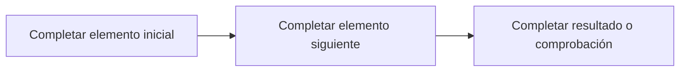

# Plantilla de sesión — UF0323

<!--
Plantilla reutilizable para redactar una sesión de UF0323. Sustituye cada
placeholder por información específica de la sesión y elimina las instrucciones
que ya no sean necesarias. Esta plantilla no es una sesión completa.
-->

## 1. Ficha de sesión

<!-- Completa la identificación y las condiciones de trabajo de la sesión. -->

- **Identificador:** [Completar]
- **Título:** [Completar]
- **Bloque pedagógico:** [Completar: B1, B2, B3, B4, B5 o B6]
- **Duración:** [Completar]
- **Prerrequisitos:** [Completar]
- **Herramienta base:** PowerPoint o equivalente — [Completar herramienta y versión, si procede]
- **Materiales:** [Completar]
- **Tipo de sesión:** [Completar]

## 2. Objetivos observables

<!-- Formula resultados que puedan observarse o comprobarse al terminar. -->

Al finalizar la sesión, el alumnado podrá:

- [Completar objetivo observable 1]
- [Completar objetivo observable 2]
- [Completar objetivo observable 3]

## 3. Mapa visual

<!--
Decide si un mapa facilita la comprensión de las relaciones o la secuencia.
Conserva el diagrama solo si aporta valor didáctico y acompáñalo de su lectura.
Reserva aquí espacio para Mermaid sin configurar la navegación del sitio.
-->

### Mapa Mermaid (opcional)

**Lectura guiada del mapa:** [Completar qué relación, dependencia o secuencia debe observarse]

### Alternativa textual accesible

[Completar la misma información del mapa en una secuencia o lista textual.]

## 4. Reto o situación inicial

<!-- Presenta el punto de partida sin resolverlo todavía. -->

### Contexto

[Completar contexto de uso, destinatario y propósito.]

### Problema

[Completar problema que debe abordarse con la presentación.]

### Pregunta guía

[Completar pregunta que oriente las decisiones de la sesión.]

### Condiciones

- [Completar condición de contenido, formato o soporte]
- [Completar condición de organización, seguridad o entrega, si procede]
- [Completar limitación de tiempo, herramienta o infraestructura]

## 5. Conceptos

<!--
Desarrolla solo los conceptos necesarios para esta sesión. Explica su relación
con el reto antes de pedir que se apliquen y señala sus dependencias.
-->

### Concepto [Completar]

- **Relación con el reto:** [Completar]
- **Dependencias:** [Completar conocimientos o decisiones previas]
- **Errores frecuentes:** [Completar]

### Concepto [Completar]

- **Relación con el reto:** [Completar]
- **Dependencias:** [Completar conocimientos o decisiones previas]
- **Errores frecuentes:** [Completar]

## 6. Demostraciones

<!--
Incluye una ficha por demostración. La demostración muestra un procedimiento;
no sustituye a los ejercicios ni a sus comprobaciones.
-->

### Demostración [Completar identificador]

- **Punto didáctico:** [Completar concepto o decisión que se hace visible]
- **Objetivo:** [Completar resultado de la demostración]
- **Prerrequisitos:** [Completar]
- **Pasos resumidos:**
  1. [Completar]
  2. [Completar]
  3. [Completar]
- **Resultado visible:** [Completar qué debe observarse en PowerPoint o equivalente]
- **Comprobación:** [Completar cómo se verifica el resultado]

### Demostración [Completar identificador]

- **Punto didáctico:** [Completar concepto o decisión que se hace visible]
- **Objetivo:** [Completar resultado de la demostración]
- **Prerrequisitos:** [Completar]
- **Pasos resumidos:**
  1. [Completar]
  2. [Completar]
  3. [Completar]
- **Resultado visible:** [Completar qué debe observarse en PowerPoint o equivalente]
- **Comprobación:** [Completar cómo se verifica el resultado]

## 7. Ejercicios intercalados

<!--
Añade un slot inmediatamente después del concepto o demostración pertinente.
Cada ejercicio es una actividad individual sin entrega formal. No escribas aquí
enunciados, soluciones ni pistas: esos elementos pertenecen a una sesión
desarrollada y, si procede, a la plantilla canónica definida para otra issue.
Puedes reservar espacio para extensiones editoriales como admonitions, tabs o
details cuando se decida su uso, sin configurarlas en esta plantilla.
-->

### Ejercicio intercalado [Completar identificador]

- **Concepto previo:** [Completar]
- **Finalidad:** [Completar qué se practica]
- **Modalidad:** actividad individual, sin entrega formal
- **Resultado esperado:** [Completar resultado observable]
- **Comprobación:** [Completar cómo comprueba el alumnado el resultado]

### Ejercicio intercalado [Completar identificador]

- **Concepto previo:** [Completar]
- **Finalidad:** [Completar qué se practica]
- **Modalidad:** actividad individual, sin entrega formal
- **Resultado esperado:** [Completar resultado observable]
- **Comprobación:** [Completar cómo comprueba el alumnado el resultado]

## 8. Producto de sesión

<!-- Describe el producto que queda al finalizar, sin convertirlo en una entrega formal. -->

- **Resultado observable:** [Completar producto o estado final visible]
- **Mínimos de comprobación:**
  - [Completar mínimo de calidad o contenido 1]
  - [Completar mínimo de calidad o contenido 2]
  - [Completar mínimo de comprobación 3]

## 9. Recapitulación

<!-- Cierra la sesión y prepara la conexión con el aprendizaje posterior. -->

### Ideas clave

- [Completar]
- [Completar]

### Errores a evitar

- [Completar]
- [Completar]

### Comprobación final

[Completar una comprobación breve del logro de los objetivos observables.]

### Conexión con la siguiente sesión o bloque

[Completar qué resultado, decisión o pregunta se retoma a continuación.]

## 10. Trazabilidad

<!--
Completa la relación curricular con la numeración operativa aprobada. Mantén la
referencia normativa rastreable y distingue el bloque oficial del pedagógico.
-->

- **Capacidad:** [Completar: C1 o C2]
- **Criterio de evaluación (CE):** [Completar: CE1.1–CE1.4 o CE2.1–CE2.3]
- **Bloque oficial:** [Completar]
- **Bloque pedagógico:** [Completar: B1–B6 y denominación]
- **Evidencia:** [Completar resultado observable que demuestra la cobertura]
- **Referencia normativa:** [Completar disposición, apartado y/o página verificable]
