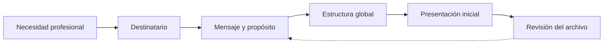

# Sesión 1 — Finalidad y estructura inicial

## 1. Ficha de sesión

- **Identificador:** UF0323-S01
- **Título:** Finalidad y estructura inicial
- **Duración:** 4 h (240 min): B1, 3 h; B2, 1 h.
- **Prerrequisitos:** UF0319 superada como condición normativa de acceso; comprensión de instrucciones, manejo básico de archivos y del entorno digital, y nociones elementales de revisión, seguridad e integridad de la información.
- **Herramienta base:** Microsoft PowerPoint. Se trabajará con las funciones disponibles en el equipo del aula; no se necesitan herramientas online.
- **Materiales:** equipo individual, PowerPoint, carpeta local de trabajo, datos ficticios o anonimizados del caso y esta guía.
- **Modalidad:** individual y sin entrega formal. El resultado se revisa durante la sesión mostrando la aplicación; no se adjuntan ni se envían archivos. Puede hacerse una revisión síncrona opcional por Teams compartiendo pantalla en el momento indicado en cada actividad; compartir pantalla solo permite observar y comentar el trabajo, no implica enviar ni entregar archivos.

<!-- Trazabilidad interna: esta sesión aplica la decisión vigente de no solicitar
entregas ni envíos por Teams; la programación administrativa histórica requiere
sincronización futura. -->

### Distribución temporal exacta

| Tramo | Tiempo | Actividad principal |
|---|---:|---|
| Diagnóstico y encuadre | 20 min | Reto, destinatario, propósito y situación de partida. |
| Explicación | 60 min | Conceptos de finalidad, mensaje, claridad, persuasión, estilo y archivo. |
| Análisis guiado | 90 min | D1 (15), E1 (15), D2 (15), E2 (15), E3 (20) y pausa integrada (10). Incluye todas las demostraciones y prácticas de análisis. |
| Producción | 40 min | D3 (10), E4 (20) y D4 (10). Incluye la conversión del mapa en diapositivas y la revisión del archivo. |
| Puesta en común y cierre | 30 min | Revisión visible, recapitulación y conexión con la sesión 2. |
| **Total** | **240 min** | **No se añaden pausas ni tiempos adicionales.** |

## 2. Objetivos observables

Al finalizar la sesión, el alumnado podrá:

- formular por escrito la necesidad, el propósito, el destinatario y el mensaje principal de una presentación profesional;
- distinguir el contenido de una diapositiva de la arquitectura global de la presentación;
- proponer una secuencia comprensible de 6–8 diapositivas, con inicio, desarrollo y cierre;
- reconocer cómo la imagen corporativa, las normas de estilo, la claridad y la persuasión afectan a la comprensión del mensaje;
- crear en PowerPoint una presentación inicial de 6–8 diapositivas a partir del mapa de mensaje;
- guardar, cerrar, reabrir y revisar el archivo, comprobando su nombre, ubicación, integridad y confidencialidad.

## 3. Mapa visual de la progresión

El mapa muestra que una presentación no empieza eligiendo un diseño: comienza con una necesidad de comunicación y termina con una primera comprobación del archivo. La flecha de retorno recuerda que la revisión puede obligar a ajustar el mensaje o la estructura.

**Lectura guiada:** la necesidad explica por qué se comunica; el destinatario determina qué necesita comprender; el propósito y el mensaje orientan la selección; la estructura ordena las ideas; PowerPoint hace visible una primera versión; la revisión comprueba que el resultado corresponde a lo previsto.

### Alternativa textual accesible

1. Identificar la necesidad que origina la comunicación.
2. Precisar quién recibirá la presentación y qué conoce ya.
3. Formular el propósito y una idea principal que se desea recordar.
4. Ordenar las ideas en una arquitectura de 6–8 diapositivas.
5. Crear esa secuencia inicial en PowerPoint.
6. Guardar, cerrar, reabrir y revisar; si algo no se entiende, volver al mensaje o a la estructura.

## 4. Reto o situación profesional inicial

### Contexto

Una pequeña empresa quiere explicar a su equipo una nueva forma de registrar solicitudes de clientes. La persona responsable necesita una presentación breve para una reunión interna. El alumnado debe preparar el esqueleto de esa presentación antes de incorporar objetos y composición avanzada en sesiones posteriores.

### Destinatario y propósito

- **Destinatario:** personal administrativo que conoce el trabajo diario, pero todavía no conoce el nuevo procedimiento.
- **Propósito:** conseguir que comprenda por qué se cambia el registro y qué tres pasos debe seguir.
- **Mensaje guía:** «Un registro uniforme reduce errores y permite responder mejor; para aplicarlo hay que identificar, registrar y comprobar cada solicitud».

### Problema

Un conjunto de ideas correctas, pero desordenadas o demasiado extensas, puede hacer que el equipo no recuerde qué debe hacer. Hay que decidir qué entra en la presentación, qué orden facilita la comprensión y qué información debe quedar fuera de la primera versión.

### Pregunta guía

**¿Cómo convertir una necesidad de comunicación en una presentación breve, clara, persuasiva y organizada que el destinatario pueda utilizar?**

### Condiciones

- Trabajar individualmente en PowerPoint y con información ficticia o anonimizada.
- Preparar únicamente la finalidad, el mensaje y la estructura inicial; no se requieren audio, vídeo, animaciones, transiciones ni composición avanzada de objetos.
- Mantener entre 6 y 8 diapositivas, con un nombre de archivo identificable y una ubicación local controlada.
- Revisar el archivo en la propia aplicación, sin entrega formal ni envío.

## 5. Conceptos

### Finalidad, necesidad y propósito

La **necesidad** es la situación que hace necesaria la comunicación: informar de un cambio, explicar una propuesta, orientar una decisión o facilitar un procedimiento. El **propósito** concreta qué debe ocurrir después de ver la presentación: comprender una razón, recordar unos pasos o decidir una acción. Si no se formula, la presentación tiende a acumular información sin dirección.

Una formulación útil une situación, destinatario y resultado: «El personal administrativo necesita conocer el nuevo registro para aplicarlo sin omitir datos». Esta frase permite decidir qué información es pertinente y qué contenido pertenece a otra comunicación.

### Destinatario y mensaje

El destinatario no es una etiqueta decorativa. Sus conocimientos, responsabilidades, dudas y contexto determinan el vocabulario, el nivel de detalle y el orden de las explicaciones. El mensaje principal es la idea que debe permanecer después de la presentación; las demás ideas deben explicarlo, demostrarlo o conducir a una acción.

Para comprobarlo, se puede completar esta ficha: **Quién debe entenderlo**, **qué debe recordar**, **qué debe hacer** y **qué evidencia necesita para confiar**. Un mensaje claro no intenta decirlo todo: selecciona lo necesario para que esa persona pueda interpretar y actuar.

### Imagen corporativa y normas de estilo

La imagen corporativa es la impresión que la organización transmite mediante sus documentos, lenguaje y forma de presentarse. Una presentación profesional debe ser reconocible y coherente con la organización: no basta con que tenga colores atractivos. Las normas de estilo pueden fijar logotipo, colores, tipografías, tono, forma de nombrar procesos o uso de plantillas.

En esta sesión se toman decisiones iniciales, no se desarrolla una composición visual completa. Se anota cualquier regla conocida y, cuando no exista una guía, se eligen opciones sobrias y consistentes. La coherencia ayuda a interpretar la información y evita que el diseño compita con el mensaje.

### Claridad y persuasión

La **claridad** permite localizar la idea, distinguir lo principal de lo secundario y seguir el orden sin esfuerzo innecesario. Se apoya en títulos informativos, frases breves, vocabulario adecuado, una idea dominante por diapositiva y una secuencia previsible.

La **persuasión** no significa exagerar ni presionar. Consiste en relacionar una necesidad con una razón comprensible, mostrar un beneficio creíble y proponer una acción concreta. Por ejemplo, «Registrar los tres datos evita devoluciones» es más útil que «Mejoraremos mucho el servicio», porque conecta acción y consecuencia. Claridad y persuasión se necesitan mutuamente: un argumento confuso no convence y un mensaje claro pero sin propósito no orienta.

### Estructura narrativa inicial

La estructura global es el recorrido que hace el destinatario por la presentación. Para este reto puede seguirse una secuencia de ocho posiciones:

1. **Portada e identificación:** tema y contexto.
2. **Situación:** qué ocurre ahora.
3. **Necesidad o problema:** qué dificultad se debe resolver.
4. **Propósito y mensaje:** qué se propone comprender.
5. **Solución o procedimiento:** qué se hará.
6. **Pasos o criterios:** cómo se aplicará.
7. **Beneficio y comprobación:** qué mejora y cómo se sabrá.
8. **Cierre:** idea que se debe recordar y siguiente acción.

Se pueden usar seis o siete posiciones fusionando las que tengan poca información. La estructura no obliga a redactar todavía el texto definitivo: funciona como un mapa para no perder el hilo.

### Contenido de una diapositiva y arquitectura global

El **contenido de la diapositiva** es lo que aparece en una unidad concreta: título, frase, lista o dato. La **arquitectura global** es la relación entre todas las diapositivas: qué pregunta responde cada una, qué dependencia tiene y por qué aparece en ese lugar. Una diapositiva puede estar bien escrita y, aun así, romper la historia si repite una idea, adelanta una conclusión o deja un salto sin explicación.

Antes de editar detalles conviene leer solo los títulos en la vista de esquema o clasificador. Si esos títulos ya cuentan el recorrido, la arquitectura es legible. Después se comprueba cada diapositiva por separado: el contenido debe apoyar su función y no convertirse en un párrafo que sustituya a la exposición.

### Organización, guardado, revisión, integridad y confidencialidad

Organizar significa usar una carpeta y un nombre que permitan localizar el trabajo: por ejemplo, `S01_registro_solicitudes_inicial.pptx`. Guardar no es una acción final aislada: se guarda después de crear la presentación y tras cambios relevantes. Cerrar y reabrir sirve para comprobar que el archivo conserva su estructura y que no se estaba trabajando en una ubicación temporal o equivocada.

La **integridad** exige que la presentación reabierta coincida con lo que se editó. La **confidencialidad** exige no introducir datos personales reales en un ejercicio de aprendizaje y no dejar copias en ubicaciones compartidas sin autorización. La revisión compara necesidad, destinatario, mensaje, orden, legibilidad básica y estado del archivo. En esta sesión se revisa el contenido visible y la operación básica de archivo; la protección y las salidas se desarrollarán cuando corresponda.

## 6. Demostraciones en PowerPoint

Las demostraciones se reproducen con una presentación vacía y datos ficticios. Los nombres de menús pueden variar ligeramente según la versión, pero siempre se utiliza la función equivalente de PowerPoint.

### D1. De la necesidad al propósito

- **Objetivo:** convertir una petición general en una ficha concreta de propósito y destinatario.
- **Preparación:** abrir PowerPoint y crear una presentación en blanco; usar el caso del registro de solicitudes.
- **Pasos:**
  1. Escribir la necesidad: «Se registran solicitudes de forma desigual y se pierden datos».
  2. Identificar el destinatario y sus conocimientos: «Personal administrativo; conoce la atención, pero no el nuevo registro».
  3. Redactar el propósito con un verbo observable: «Al terminar, podrá identificar, registrar y comprobar una solicitud».
  4. Reducir la idea a un mensaje principal y anotar dos o tres ideas de apoyo.
  5. Guardar la ficha como nota de planificación local, separada de las diapositivas finales. No es una diapositiva adicional.
- **Resultado visible:** una nota de planificación con necesidad, destinatario, propósito, mensaje y apoyos claramente diferenciados.
- **Comprobación:** leer la ficha y responder: «¿Quién hará qué después de ver la presentación?». Si no se puede responder en una frase, ajustar el propósito.

### D2. Claridad y persuasión: antes y después

- **Objetivo:** reconocer y corregir un mensaje ambiguo, extenso o poco orientado a la acción.
- **Preparación:** disponer de estos dos textos ficticios.

  - **Antes:** «La empresa considera importante mejorar de manera significativa el proceso de gestión de las solicitudes recibidas para conseguir resultados mejores en la atención y evitar problemas que pueden aparecer en distintos momentos».
  - **Después posible:** «Registrar los tres datos clave evita devoluciones y acelera la respuesta».

- **Pasos:**
  1. Copiar ambos textos en dos diapositivas consecutivas.
  2. Añadir a la versión «Antes» un título que describa su problema: «Mensaje sin foco».
  3. Reescribir la versión «Después» con un verbo o acción, una razón y un beneficio.
  4. Limitar la diapositiva a una idea principal y dos apoyos como máximo.
  5. Leer ambas en voz baja y eliminar palabras que no cambien el sentido.
- **Resultado visible:** dos diapositivas comparables en las que la segunda permite localizar destinatario implícito, acción, razón y beneficio con mayor rapidez.
- **Comprobación:** tapar el cuerpo de la segunda diapositiva y leer solo el título; después explicar en una frase qué se debe hacer y para qué. Si falta una de las dos partes, reescribir.

### D3. Estructura inicial de 6–8 diapositivas

- **Objetivo:** demostrar cómo transformar el mapa de mensaje de E3 en una estructura técnica de 6–8 diapositivas, sin crear todavía el producto final.
- **Preparación:** tener terminado el mapa de E3 y disponible la ficha de D1 como referencia.

E3 termina con un mapa de trabajo. D3 muestra el procedimiento de conversión y deja claro qué hará después E4. El mapa y la ficha se conservan como documentos de trabajo y no se añaden como diapositivas a la presentación.
- **Pasos:**
  1. Mostrar cómo cada posición del mapa se convierte en una diapositiva, sin completar la presentación del alumnado.
  2. Tomar como ejemplo títulos funcionales: «Situación actual», «Problema», «Propuesta», «Pasos», «Comprobación» y «Cierre».
  3. Mostrar en **Clasificador de diapositivas** (o la vista equivalente) cómo se comprobaría el orden de conjunto.
  4. Mostrar en **Esquema** (o el panel equivalente) cómo se revisaría que los títulos forman una narración continua.
  5. Explicar que E4 creará la estructura de 6–8 diapositivas y que D4 comprobará después el archivo, sin duplicar esas tareas.
- **Resultado visible:** un ejemplo de conversión del mapa a una secuencia técnica y una explicación clara del procedimiento que se aplicará en E4; no se crea aquí el producto final.
- **Comprobación:** leer el mapa y señalar qué función tendría cada diapositiva, respondiendo «¿qué problema se resuelve, cómo y qué ocurre después?».

### D4. Guardado, cierre, reapertura y revisión

- **Objetivo:** comprobar que la estructura creada en E4 queda guardada, cerrada, reabierta y corregida si procede; D4 no crea ni rediseña el producto.
- **Pasos:**
  1. Crear o seleccionar una carpeta local de trabajo y guardar como `S01_registro_solicitudes_inicial.pptx`.
  2. Confirmar en la barra de título o en la información del archivo que se ha guardado en la ubicación prevista.
  3. Guardar de nuevo y cerrar la presentación desde PowerPoint, sin apagar la aplicación de forma abrupta.
  4. Abrir el archivo desde la carpeta local y comprobar que aparecen todas las diapositivas.
  5. Comprobar títulos, orden, datos ficticios, legibilidad básica y correspondencia con el propósito.
  6. Si se detecta una corrección necesaria, aplicarla, guardar de nuevo y cerrar dejando una versión reconocible; no añadir contenido fuera de la estructura de E4.
- **Resultado visible:** archivo `.pptx` localizado, reabierto sin aviso de recuperación y con la misma estructura revisada.
- **Comprobación:** mostrar la carpeta y la presentación reabierta; contar las diapositivas, leer sus títulos y explicar una corrección realizada o justificar que no fue necesaria.

## 7. Ejercicios intercalados

Los cuatro ejercicios son individuales, se realizan en el momento indicado y se revisan en clase. No se solicita adjuntar, entregar ni enviar ningún archivo. La revisión se hace mostrando la aplicación al docente en el aula; no constituye una entrega.

### E1. Propósito y destinatario

- **Tipo y momento:** caso abierto breve; después de D1.
- **Duración orientativa:** 15 min, dentro del análisis guiado.
- **Herramienta:** PowerPoint y sus notas de planificación; la ficha no se convierte en una diapositiva adicional.
- **Finalidad:** decidir para quién se comunica y qué cambio observable se espera.

#### Contexto

Una organización detecta que las personas nuevas no encuentran rápidamente el procedimiento para solicitar material de oficina. Debe preparar una presentación breve para explicar el nuevo circuito. Elige un destinatario profesional concreto y formula una finalidad; no diseñes todavía las diapositivas finales.

#### Recursos

- PowerPoint en el equipo individual.
- El caso anterior y datos ficticios.
- Cuatro preguntas de apoyo: quién, para qué, qué debe recordar y qué debe hacer.

#### Instrucciones

Escribe una ficha que distinga necesidad, destinatario, propósito, mensaje principal y dos ideas de apoyo. Puedes elegir entre personal nuevo, responsables de departamento o personal de recepción, pero debes justificar qué necesita comprender ese destinatario.

#### Pasos secuenciados

1. Describe en una frase la dificultad de partida.
2. Selecciona un destinatario y anota qué sabe y qué desconoce.
3. Redacta un propósito con un verbo observable.
4. Resume el mensaje en una frase y añade dos apoyos.
5. Lee la ficha como si fueras el destinatario y ajusta el vocabulario.

**Comprobación parcial:** después del paso 3, comprueba que el propósito se puede observar en una acción o explicación, no solo en «conocer» o «mejorar».

#### Resultado esperado y criterios de éxito

Debe quedar visible una ficha coherente en PowerPoint. Tiene éxito si identifica una necesidad concreta, nombra un destinatario realista, formula un propósito observable, diferencia mensaje y apoyos y mantiene datos ficticios.

#### Forma, momento y canal de revisión

Al terminar el paso 5, realiza esta revisión autónoma: **¿la necesidad describe un problema concreto?, ¿el destinatario sabe qué debe hacer y qué desconoce?, ¿el propósito se puede observar en una acción?** Si alguna respuesta es negativa, reescribe la ficha. En una revisión síncrona opcional por Teams, comparte pantalla justo al terminar el paso 5 y explica durante un minuto por qué elegiste ese destinatario; compartir pantalla no implica enviar ni entregar la ficha ni ningún archivo.

#### Ayuda y errores frecuentes

**Ayuda:** si el propósito es muy amplio, completa «Al terminar, el destinatario podrá…». Si hay demasiadas ideas, elige la que responde directamente a la necesidad.

**Errores frecuentes:** confundir destinatario con la empresa; escribir una actividad del autor en lugar de un resultado del público; incluir varios mensajes sin jerarquía; usar datos personales reales. Se corrigen volviendo a las cuatro preguntas y sustituyendo los datos reales por ejemplos ficticios.

#### Accesibilidad y trazabilidad

Usa títulos explícitos, texto legible y suficiente contraste; no dependas solo del color para distinguir mensaje y apoyos. La ficha debe poder leerse con teclado y explicarse oralmente o por escrito. **Trazabilidad:** UF0323, contenido 1 «Diseño, organización y archivo de las presentaciones»; C1, CE1.1; referencia operativa RD 645/2011, UF0323, pp. 246–249 (criterio en pp. 246–247).

### E2. Claridad de mensaje

- **Tipo y momento:** práctica guiada; después de D2.
- **Duración orientativa:** 15 min, dentro del análisis guiado.
- **Herramienta:** PowerPoint.
- **Finalidad:** mejorar un mensaje para que el destinatario identifique acción, razón y beneficio.

#### Contexto

El mensaje de una presentación sobre incidencias dice: «Es importante gestionar adecuadamente las incidencias para que todo funcione mejor». Practicarás una reescritura guiada sin añadir elementos decorativos ni efectos.

#### Recursos

- PowerPoint y dos diapositivas vacías.
- El mensaje inicial y la fórmula «acción + razón + beneficio».
- La ficha de destinatario de E1 como referencia.

#### Instrucciones

Coloca el mensaje inicial en una diapositiva y crea una segunda versión. Haz que el nuevo texto diga qué se hace, por qué y qué mejora obtiene el destinatario. Mantén la idea y evita promesas no demostrables.

#### Pasos secuenciados

1. Copia el mensaje inicial y marca las palabras vagas o generales.
2. Escribe la acción concreta que el destinatario debe realizar.
3. Añade la razón relacionada con el problema.
4. Añade el beneficio observable y revisa la longitud.
5. Compara ambas diapositivas en vista normal y comprueba que la segunda tiene una sola idea dominante.

**Comprobación parcial:** después del paso 3, lee solo la acción y la razón; deben formar una instrucción comprensible sin el resto del párrafo.

#### Resultado esperado y criterios de éxito

Quedan dos versiones claramente diferenciadas. La versión mejorada contiene una acción concreta, una razón relacionada y un beneficio plausible; se entiende al leer el título y el cuerpo sin depender de explicaciones externas.

#### Forma, momento y canal de revisión

Al terminar el paso 5, realiza esta revisión autónoma: **¿la versión mejorada expresa una acción concreta?, ¿relaciona esa acción con una razón?, ¿el beneficio es plausible y se entiende sin explicación oral?** Corrige la frase si falla alguna respuesta. En una revisión síncrona opcional por Teams, comparte pantalla justo al terminar el paso 5 para explicar qué palabra o frase eliminaste; compartir pantalla no implica enviar ni entregar el archivo.

#### Ayuda y errores frecuentes

**Ayuda:** pregunta «¿qué hará exactamente la persona?» y sustituye «mejorar», «adecuadamente» o «mucho» por una acción o resultado verificable. Si el texto crece, divide razón y beneficio en dos apoyos breves.

**Errores frecuentes:** cambiar solo el tamaño de letra y no el mensaje; convertir la diapositiva en un párrafo; prometer resultados absolutos; mezclar tres acciones distintas. Corrige manteniendo una acción principal.

#### Accesibilidad y trazabilidad

Mantén lectura lineal, tamaño suficiente y contraste; identifica «Antes» y «Después» con texto, no solo con color. Proporciona una lectura textual equivalente si el estudiante no puede trabajar con el ratón. **Trazabilidad:** UF0323, contenido 1.5 «Claridad en la información» y 1.6 «La persuasión en la transmisión de la idea»; C1, CE1.1; RD 645/2011, UF0323, pp. 246–247.

### E3. Mapa de mensaje y secuencia

- **Tipo y momento:** práctica guiada; antes de D3.
- **Duración orientativa:** 20 min, dentro del análisis guiado.
- **Herramienta:** PowerPoint, una nota de planificación y la vista Esquema o Clasificador de diapositivas. El mapa es un documento de trabajo, no una diapositiva adicional.
- **Finalidad:** pasar de ideas sueltas a una arquitectura de 6–8 diapositivas.

#### Contexto

Para el caso del registro de solicitudes ya se conocen la necesidad y el mensaje. Dispones de estas ideas: situación actual, datos que se pierden, nuevo registro, tres pasos, ejemplo ficticio, comprobación y llamada a la acción. Debes ordenarlas sin redactar todavía una presentación completa.

#### Recursos

- Ficha de E1 y mensaje revisado en E2.
- Lista de ideas del caso.
- PowerPoint en blanco, vista de esquema y clasificador.

#### Instrucciones

Construye un mapa de 6–8 posiciones. Asigna a cada posición una función y un título informativo. Si fusionas dos ideas, anota por qué; si descartas una, explica qué otra posición la cubre.

#### Pasos secuenciados

1. Coloca portada y cierre como límites del recorrido.
2. Sitúa entre ambos la situación, el problema, la propuesta y su aplicación.
3. Distribuye los pasos, ejemplo o comprobación donde ayuden a entender la propuesta.
4. Escribe títulos que permitan leer la historia sin abrir el contenido.
5. Comprueba el orden en Clasificador y ajusta repeticiones o saltos.

**Comprobación parcial:** después del paso 4, lee solo los títulos de izquierda a derecha o de arriba abajo; debe aparecer una relación problema → propuesta → aplicación → comprobación.

#### Resultado esperado y criterios de éxito

Se obtiene un mapa de 6–8 posiciones, con una función por diapositiva, títulos informativos, un inicio reconocible, desarrollo y cierre. Tiene éxito si el orden se puede explicar sin añadir información que no figure en el mapa.

#### Forma, momento y canal de revisión

Al finalizar el paso 5 y antes de D3, realiza esta revisión autónoma leyendo solo los títulos: **¿aparecen problema, propuesta, aplicación y comprobación en ese orden?, ¿cada posición tiene una función distinta?, ¿puedo explicar el recorrido sin añadir información?** Ajusta el mapa si alguna respuesta es negativa. En una revisión síncrona opcional por Teams, comparte pantalla en ese momento, antes de convertir el mapa en diapositivas; compartir pantalla no implica enviar ni entregar un mapa separado.

#### Ayuda y errores frecuentes

**Ayuda:** formula la pregunta que responde cada diapositiva. Si dos responden a la misma pregunta, fusiónalas o cambia la función de una. Usa la secuencia de ocho posiciones como referencia, no como obligación rígida.

**Errores frecuentes:** empezar por colores y plantillas; usar títulos genéricos como «Introducción» o «Más información»; ordenar por disponibilidad de datos y no por comprensión; crear una diapositiva por cada frase. Corrige escribiendo primero la función y después el título.

#### Accesibilidad y trazabilidad

Usa títulos únicos y descriptivos, orden lógico de lectura y una alternativa textual en forma de lista para quien no pueda interpretar el clasificador visual. Comprueba con zoom suficiente que los títulos se leen sin esfuerzo y, cuando esté disponible, verifica el orden con el lector de pantalla o la lectura en voz alta. El significado no depende de colores, iconos o posición. **Trazabilidad:** UF0323, contenidos 2 «Introducción y conceptos generales» y 3 «Acciones con diapositivas»; C2, CE2.1; relación con C1, CE1.1; RD 645/2011, UF0323, pp. 246–249 (contenidos en pp. 247–249).

### E4. Estructura inicial en PowerPoint

- **Tipo y momento:** práctica guiada de producción; durante la producción, después de D3 y antes de D4.
- **Duración orientativa:** 20 min, dentro de producción.
- **Herramienta:** PowerPoint; la presentación final tiene exactamente 6–8 diapositivas y no duplica necesariamente la ficha ni el mapa, que siguen siendo notas de planificación.
- **Finalidad:** crear la estructura de una primera presentación editable a partir del mapa; el archivo se comprueba después en D4.

#### Contexto

Ahora transformarás el mapa de E3 en una presentación inicial sobre el registro de solicitudes. La versión es un esqueleto funcional: debe mostrar la arquitectura y el mensaje, no resolver todavía la composición, los objetos o los efectos.

#### Recursos

- Mapa de E3 y ficha de propósito.
- PowerPoint y carpeta local de trabajo.
- Datos ficticios; nombre sugerido `S01_registro_solicitudes_inicial.pptx`.

#### Instrucciones

Inserta y ordena 6–8 diapositivas a partir del mapa de E3, escribe títulos y una cantidad breve de contenido de apoyo y deja creada la estructura. No uses herramientas online ni añadas audio, vídeo, animaciones, transiciones o composición avanzada. El guardado, el cierre, la reapertura y la comprobación final corresponden exclusivamente a D4.

#### Pasos secuenciados

  1. Crea una presentación en blanco e inserta las diapositivas que corresponden al mapa.
  2. Copia o adapta los títulos funcionales y coloca una o dos ideas de apoyo donde sean necesarias.
  3. Revisa en Normal, Esquema y Clasificador (o sus equivalentes).
  4. Inserta, elimina, duplica u ordena si detectas un problema de estructura.
  5. Deja diferenciadas la ficha y el mapa como documentos de trabajo.
  6. No conviertas la ficha ni el mapa en diapositivas ni los dupliques dentro de la presentación.

**Comprobación parcial:** después del paso 3, los títulos deben conservar la secuencia de E3; al terminar E4, la estructura queda preparada para la comprobación de archivo de D4.

#### Resultado esperado y criterios de éxito

Queda creada una presentación PowerPoint de 6–8 diapositivas, con propósito y destinatario reconocibles, secuencia problema → propuesta → aplicación → cierre, títulos legibles y datos no sensibles. D4 comprobará el nombre, la ubicación, la reapertura y la corrección del archivo.

#### Forma, momento y canal de revisión

Al finalizar la creación de la estructura, realiza esta revisión autónoma: **¿hay exactamente 6–8 diapositivas y siguen el mapa de E3?, ¿los títulos permiten entender problema, propuesta, aplicación y cierre?, ¿la ficha y el mapa siguen siendo documentos de trabajo separados?** Corrige la estructura si alguna respuesta es negativa. La comprobación del archivo corresponde a D4. En una revisión síncrona opcional por Teams, comparte pantalla solo para observar y comentar el resultado; no se adjunta, envía ni entrega el PPTX ni las notas de planificación.

#### Ayuda y errores frecuentes

**Ayuda:** vuelve al mapa si no sabes qué diapositiva crear; usa la vista Esquema para editar títulos; si una diapositiva contiene demasiadas ideas, conserva solo la que cumple su función y déjala marcada para ampliarla en la siguiente sesión.

**Errores frecuentes:** crear más de ocho diapositivas por fragmentar frases; perder el orden al duplicar; guardar en una carpeta distinta; cerrar sin guardar; introducir nombres o datos reales; confundir una portada atractiva con una estructura completa. Corrige con el clasificador, la ruta visible y una reapertura de prueba.

#### Accesibilidad y trazabilidad

Mantén títulos descriptivos, lectura lógica, texto legible, contraste suficiente y significado no dependiente del color. Usa zoom para revisar la legibilidad y, cuando esté disponible, comprueba el orden con el lector de pantalla o la lectura en voz alta. Todas las operaciones deben poder realizarse con teclado o con una alternativa de acceso asistido; la revisión puede apoyarse en una explicación oral o escrita. **Trazabilidad:** UF0323, contenidos 2 y 3; C2, CE2.1 y cobertura introductoria de CE2.3 (crear, guardar, abrir y cerrar); relación con C1, CE1.2 y CE1.4; RD 645/2011, UF0323, pp. 246–249.

## 8. Producto de sesión

Al finalizar queda, para uso personal durante el curso:

- una ficha de finalidad, destinatario, propósito y mensaje principal, como nota de planificación;
- un mapa de mensaje con la función y el orden de cada diapositiva, como nota de planificación;
- una estructura inicial de exactamente 6–8 diapositivas en PowerPoint; la presentación no duplica necesariamente la ficha ni el mapa;
- un archivo local guardado, cerrado, reabierto y revisado, sin entrega formal.

Los mínimos de comprobación son: propósito y destinatario identificables; mensaje y secuencia comprensibles; títulos y contenido inicial legibles; nombre y ubicación del archivo reconocibles; ausencia de datos personales reales; y revisión posterior a la reapertura.

### Revisión autónoma del producto final

Antes de cerrar la sesión, responde a estas preguntas críticas: **¿la presentación tiene exactamente 6–8 diapositivas y sus títulos cuentan una secuencia necesidad → propuesta → aplicación → cierre?, ¿cada diapositiva aporta una función sin copiar la ficha o el mapa?, ¿el archivo se abre de nuevo, conserva el orden y no contiene datos reales?** Si alguna respuesta es negativa, corrige y vuelve a guardar. Como alternativa asíncrona a la revisión síncrona, aplica esta misma lista de criterios al resultado reabierto, anota qué has comprobado y qué corrección, si la hubiera, realizaste; no adjuntes, envíes ni entregues archivos. De forma opcional, comparte pantalla por Teams en este momento de cierre para mostrar la presentación reabierta y recibir comentarios; compartir pantalla no implica enviar ni entregar el PPTX ni las notas de planificación.

## 9. Recapitulación

### Ideas clave

- La presentación comienza con una necesidad, un destinatario y un propósito; el diseño se decide después.
- La claridad selecciona y ordena; la persuasión conecta una acción con una razón y un beneficio creíble.
- La arquitectura global debe leerse en los títulos antes de pulir el contenido de cada diapositiva.
- Guardar, cerrar, reabrir y revisar protege la continuidad, la integridad y la confidencialidad del trabajo.

### Errores a evitar

- Empezar por colores, efectos o plantillas sin haber fijado el mensaje.
- Confundir una diapositiva con la presentación completa o llenar cada diapositiva de texto.
- Usar títulos genéricos, mezclar destinatarios o introducir información real innecesaria.
- Dar por guardado un archivo sin comprobar ubicación, reapertura y conservación del orden.

### Comprobación final

Sin rehacer la presentación, responde brevemente siguiendo esta secuencia: **necesidad → propósito → mensaje → estructura → revisión**. Pregúntate: ¿qué necesidad origina la comunicación?, ¿qué propósito observable tiene?, ¿qué mensaje debe recordar el destinatario?, ¿qué estructura de 6–8 diapositivas lo desarrolla?, ¿cómo revisaste legibilidad, orden y archivo? Si alguna respuesta no aparece en el trabajo, marca el punto para corregirlo.

### Conexión con la siguiente sesión o bloque

La sesión 2 retomará esta estructura para trabajar las vistas, la secuencia, la jerarquía y el guion o storyboard, y comenzará la composición. La pregunta pendiente es cómo convertir cada posición del mapa en una diapositiva con contenido y objetos sin perder el mensaje global.

## 10. Trazabilidad curricular de UF0323

> **Separación curricular:** esta sección documenta la cobertura de la sesión y no añade requisitos al producto ni sustituye el flujo de aprendizaje.

| Elemento | Cobertura en esta sesión |
|---|---|
| **Unidad formativa** | UF0323, «Aplicaciones informáticas para presentaciones: gráficas de información». |
| **C1** | Establecer el diseño de las presentaciones teniendo en cuenta las características de la empresa y su organización. Cobertura introductoria mediante finalidad, destinatario, imagen, claridad, persuasión, organización y archivo. |
| **CE1.1** | Importancia de la presentación para la imagen de la entidad y comunicación clara y persuasiva: conceptos, D1, D2, E1 y E2. |
| **CE1.2** | Necesidad de guardar según criterios de organización, seguridad, integridad y confidencialidad: concepto de archivo y D4. |
| **CE1.3** | Importancia de comprobar resultados y subsanar errores antes de poner la presentación a disposición: D4, E3 y E4, en alcance inicial de revisión. |
| **CE1.4** | Cobertura inicial: seleccionar una estructura y un formato de trabajo adecuados y comprobar la presentación en la aplicación. No se desarrollan todavía soportes, animación ni composición avanzada. |
| **C2** | Utilizar funciones de aplicaciones de presentaciones gráficas integrando información; cobertura introductoria mediante creación, vistas y acciones básicas con diapositivas. |
| **CE2.1** | Identificar prestaciones, procedimientos y asistentes: D3 y E3–E4 reconocen las vistas Normal, Esquema y Clasificador y las operaciones básicas de inserción, eliminación, duplicación y ordenación. |
| **CE2.2** | Cobertura introductoria: relacionar formato, soporte y organización con la naturaleza del mensaje; no se agota el criterio en esta sesión. |
| **CE2.3** | Cobertura introductoria de crear, insertar, ordenar, guardar, cerrar, abrir y revisar una presentación; animación, temporalización y protección quedan para sesiones posteriores. |
| **Bloque oficial** | 1. Diseño, organización y archivo de las presentaciones; 2. Introducción y conceptos generales; 3. Acciones con diapositivas. |
| **Bloque pedagógico** | B1. Finalidad, diseño y organización (3 h) y B2. Entorno y estructura (1 h). |
| **Evidencia observable** | Ficha de finalidad y destinatario, mapa de mensaje y presentación inicial PowerPoint de 6–8 diapositivas guardada y revisada localmente, sin entrega. |
| **Referencia normativa verificable** | Real Decreto 645/2011, UF0323, Anexo IV: identificación y capacidades/criterios en pp. 246–247; contenidos en pp. 247–249. TXT operativo `normativa/BOE-A-2011-9930.txt`; extracción curricular, líneas 258–388. |

La numeración usada para C2 es la de 2011: CE2.1, CE2.2 y CE2.3. La sesión no modifica capacidades, criterios ni contenidos oficiales; solo ofrece una cobertura introductoria y secuenciada de los elementos necesarios para continuar el curso.
