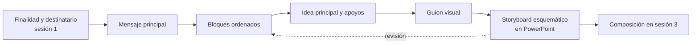

# Sesión 2 — Secuencia, jerarquía y storyboard

## 1. Ficha de sesión

- **Identificador:** UF0323-S02
- **Título:** Secuencia, jerarquía y storyboard
- **Bloques pedagógicos:** B2, Entorno y estructura (3 h); B3, Composición y objetos (1 h).
- **Subcontenidos iniciales de B3:** selección, desplazamiento, tamaño, reubicación, alineación y texto/objetos básicos aplicados a una composición inicial acotada; no se aborda todavía la composición avanzada.
- **Duración:** 4 h (240 min).
- **Prerrequisitos:** Haber definido en la sesión 1 la finalidad, el destinatario, el mensaje y una estructura inicial de 6–8 diapositivas, o seguir la ruta de recuperación textual de esta sesión; manejo básico de archivos y de PowerPoint.
- **Herramienta base:** Microsoft PowerPoint, con las funciones disponibles en el equipo. No se utilizan herramientas online.
- **Materiales:** equipo individual, PowerPoint y carpeta local. El trabajo de la sesión 1, si se conserva, puede reutilizarse con datos ficticios o anonimizados; no se necesita descargar un archivo inicial.
- **Modalidad:** individual y preparada para el autoestudio online. No se solicita una entrega formal ni el envío de archivos. La revisión es autónoma.

### Distribución temporal exacta

| Tramo | Tiempo | Trabajo principal |
|---|---:|---|
| Recuperación | 20 min | Recuperar el propósito, el mensaje y la estructura inicial de la sesión 1. |
| Explicación y demostraciones | 50 min | D1–D3: ordenación, jerarquización y conversión de la estructura en secuencia/storyboard preliminar, sin composición final. |
| Taller | 100 min | E1, E2, E3, organización/registro del storyboard preliminar, D4 y E4, en una secuencia única y sin solapamientos. |
| Revisión | 40 min | D5, E5 y comprobación final de secuencia; contraste individual opcional y dirigido por el docente, sin trabajo entre pares ni entrega. |
| Cierre | 30 min | Recapitulación y preparación de la composición de la sesión 3. |
| **Total** | **240 min** | **B2: 180 min; B3: 60 min.** |

### Desglose verificable por bloques

| Bloque | Desglose | Total |
|---|---|---:|
| **B2** | Recuperación 20 + explicación 50 + E1/E2/E3 del taller 60 + organización/registro del storyboard 10 + comprobación final de secuencia 10 + cierre 30 | **180 min (3 h)** |
| **B3** | D4 10 + E4 20 de composición inicial acotada + D5 10 + E5 20 | **60 min (1 h)** |

La secuencia operativa no solapada es la siguiente:

| Tramo | Orden y duración | Bloque | Actividad |
|---|---:|---|---|
| Taller | 20 min | B2 | E1. Ordenar bloques e ideas. |
| Taller | 20 min | B2 | E2. Distinguir idea principal, secundarias y apoyos. |
| Taller | 20 min | B2 | E3. Convertir la estructura en secuencia previa. |
| Taller | 10 min | B2 | Organización y registro del storyboard preliminar: aplicar el procedimiento único de conservación, registrar transiciones narrativas y dejar identificada la prioridad de composición. |
| Taller | 10 min | B3 | D4. Demostrar la composición inicial acotada. |
| Taller | 20 min | B3 | E4. Crear una composición inicial acotada. |
| Revisión | 10 min | B3 | D5. Demostrar la comprobación mediante miniaturas y vista general sobre la copia con la composición inicial; el storyboard original no se modifica. |
| Revisión | 20 min | B3 | E5. Aplicar la comprobación a la copia con la composición inicial, contrastarla con el storyboard original y corregir o justificar la secuencia. |
| Revisión | 10 min | B2 | Comprobación final de secuencia: verificar el recorrido completo y dejar anotada la transición a la sesión 3; no repite E5. |

Así, el taller suma **100 min** (E1 20 + E2 20 + E3 20 + organización/registro 10 + D4 10 + E4 20) y la revisión suma **40 min** (D5 10 + E5 20 + comprobación final 10). E3 aparece únicamente en el taller; E4, únicamente en el taller; y E5, únicamente en la revisión.

### Organización y registro del storyboard — 10 min

Este es el procedimiento único que se utiliza antes de la composición inicial:

1. **Conservar el original (3 min):** mantener el storyboard preliminar completo como archivo o estado de trabajo original, sin modificarlo. Identificarlo localmente con un nombre descriptivo como `storyboard-s02` y dejarlo abierto o localizado como referencia.
2. **Crear la copia de trabajo (3 min):** sobre el storyboard original, utilizar **Archivo > Guardar como** para crear una copia local diferenciada, con un nombre como `composicion-inicial-s02`, y trabajar únicamente sobre esa copia. Esta es la única operación de separación: no se duplican diapositivas dentro del mismo archivo. La copia es solo de trabajo, no se entrega ni se envía; el storyboard original se conserva sin modificar.
3. **Registrar la continuidad (2 min):** en las notas o en un cuadro de texto visible, escribir para cada posición la transición **narrativa** hacia la siguiente y marcar la primera diapositiva que se compondrá. La transición narrativa explica el paso de una idea a otra; no es un efecto de PowerPoint.
4. **Comprobar la separación (2 min):** mostrar el original y la copia en la vista Clasificador y verificar que el original conserva las etiquetas, zonas y notas del storyboard, mientras la copia queda identificada como el estado desde el que se hará E4 y se revisará después.

**Resultado visible:** dos estados reconocibles —storyboard original conservado y copia local de trabajo para la composición inicial—, una lista de transiciones narrativas y una prioridad de composición marcada. **Comprobación:** volver a leer el original sin editarlo y confirmar que la copia es la única que se modificará en E4 y la única sobre la que se aplicarán D5/E5; fuera de la operación obligatoria **Guardar como**, no se pide cubrir guardar, cerrar ni reabrir, ni entregar o enviar ningún archivo.

## 2. Objetivos observables

Al finalizar la sesión, el alumnado podrá:

- ordenar una secuencia de diapositivas a partir de la estructura inicial de la sesión 1, justificando el recorrido desde el problema hasta el cierre;
- distinguir la idea principal, las ideas secundarias y los apoyos de cada bloque;
- elaborar un guion visual y un storyboard esquemático en PowerPoint;
- convertir el storyboard en una o dos diapositivas de prueba con una composición inicial acotada, sin desarrollar todavía el producto completo;
- utilizar las vistas Normal, Esquema y Clasificador de diapositivas para ordenar, comprobar y revisar una presentación;
- revisar de forma autónoma la coherencia entre finalidad, destinatario, mensaje, jerarquía y secuencia;
- dejar preparado el storyboard que guiará la composición de la sesión 3, sin desarrollar todavía la composición completa.

## 3. Mapa visual accesible

El siguiente mapa representa cómo una decisión de la sesión 1 se convierte en una guía de trabajo para la sesión 3. Las etiquetas explican el nivel de decisión, no el aspecto visual definitivo.

**Lectura guiada:** la finalidad y el destinatario limitan lo que se cuenta; el mensaje orienta los bloques; cada bloque recibe una idea dominante y apoyos; el guion indica qué debe comunicar cada diapositiva; el storyboard sitúa esa intención en una secuencia visible. La flecha de retorno recuerda que una revisión puede obligar a reordenar bloques antes de componer.

### Alternativa textual accesible

1. Recuperar finalidad, destinatario, mensaje y estructura de la sesión 1.
2. Ordenar los bloques para formar un recorrido comprensible.
3. Asignar una idea principal y apoyos limitados a cada diapositiva.
4. Escribir un guion visual: función, contenido previsto y transición.
5. Crear un storyboard esquemático en PowerPoint.
6. Revisarlo en vista general y dejarlo como guía de composición para la sesión 3.

### Ruta de recuperación si no se conserva la sesión 1

La sesión puede realizarse sin recuperar ningún archivo. Antes de D1, escribe en una
nota de trabajo esta estructura mínima para el caso ficticio del registro de
solicitudes:

1. **Finalidad:** ayudar a que las solicitudes se registren con los datos necesarios.
2. **Destinatario:** la persona que recibe y revisa las solicitudes.
3. **Mensaje:** un registro uniforme reduce pérdidas y facilita el seguimiento.
4. **Inicio:** situación actual y problema de los datos incompletos.
5. **Desarrollo:** propuesta del nuevo registro, tres pasos de uso y un ejemplo.
6. **Cierre:** comprobación del registro y llamada a la acción.

Esta lista es la estructura de partida: no es una presentación descargable ni un
PPTX que haya que crear o conseguir. En D1, crea una presentación local en blanco
con seis diapositivas tituladas según esos seis puntos. Después continúa con D2–D5.
Si se conserva el trabajo de la sesión 1, se compara con esta ruta y se mantiene
la versión que resulte más clara, sin mezclar la presentación inicial con el
storyboard.

## 4. Reto profesional

### Contexto

La sesión 1 dejó una presentación inicial sobre un nuevo registro de solicitudes. Ahora hay que comprobar si el destinatario puede seguir el recorrido y preparar cada diapositiva antes de elegir objetos, tamaños o estilos de composición.

### Problema

Una estructura puede contener todas las ideas correctas y, aun así, resultar difícil de seguir si mezcla bloques, no distingue lo principal o adelanta apoyos antes de presentar el problema. El reto consiste en convertir la estructura inicial en un plan visual que otra persona pueda interpretar y componer.

### Pregunta guía

**¿Cómo ordenar y jerarquizar el mensaje para que cada diapositiva tenga una función clara y quede preparada para su composición posterior?**

### Condiciones

- Partir de la finalidad, el destinatario, el mensaje y la estructura inicial de la sesión 1, sin repetir su desarrollo.
- Trabajar individualmente en PowerPoint y conservar información ficticia o anonimizada.
- Crear un storyboard esquemático: se planifican posiciones, relaciones y apoyos; no se desarrolla la composición completa ni se incorporan recursos externos.
- Revisar el resultado en la propia aplicación, sin entregas ni envíos de archivos.

## 5. Conceptos autosuficientes

### Secuencia

La **secuencia** es el orden en el que el destinatario encuentra las ideas. No es solo la numeración de las diapositivas: expresa una relación de comprensión. En el caso de la sesión 1, una secuencia razonable puede avanzar de situación actual a problema, propuesta, aplicación, comprobación y cierre. Una diapositiva debe aparecer cuando el destinatario ya dispone de lo necesario para entenderla y todavía necesita esa información para avanzar.

Para revisar una secuencia, lee únicamente los títulos en el Clasificador o en el panel de Esquema. Si el recorrido exige explicar información que no aparece, hay un salto. Si dos títulos responden a la misma pregunta, probablemente existe repetición o falta una función diferenciada.

### Jerarquía

La **jerarquía** distingue la importancia y la dependencia de las ideas. La idea principal responde a la pregunta que justifica la diapositiva; las ideas secundarias explican, concretan o justifican esa idea; los apoyos son ejemplos, datos, instrucciones breves o indicaciones para la futura composición. Jerarquizar no significa decorar ni hacer una frase más grande: significa decidir qué debe recordarse y qué solo ayuda a comprenderlo.

Una prueba útil consiste en ocultar los apoyos y leer la idea principal. Debe conservarse el sentido de la diapositiva. Si desaparece el mensaje, la supuesta idea principal era un detalle o había demasiadas ideas compitiendo.

### Guion visual

El **guion visual** es una descripción breve y ordenada de lo que debe comunicar cada diapositiva. Incluye, como mínimo, su función, la idea dominante, los apoyos necesarios y la relación con la diapositiva siguiente. No es el texto definitivo ni el diseño final: es una decisión previa que evita empezar por objetos o estilos sin saber para qué sirven.

Ejemplo: «Diapositiva 4 — propuesta: mostrar que el registro uniforme reduce errores; apoyos: tres datos obligatorios; transición: después se explican los pasos». Este guion permite que la composición de la sesión 3 tenga una dirección comprobable.

### Storyboard

Un **storyboard** es la representación esquemática del guion visual. En PowerPoint puede consistir en una serie de diapositivas con títulos informativos, etiquetas de función, notas breves y cajas de posición dibujadas de forma provisional. Su finalidad es ver el conjunto y anticipar relaciones; no pretende simular la apariencia final.

Un storyboard autosuficiente permite saber qué aparece, dónde se sitúa de manera aproximada, qué debe destacar y cómo conecta con lo anterior y lo siguiente. Si solo contiene títulos genéricos o cajas sin función, todavía no es una guía útil.

### Relación entre idea, bloque, diapositiva y transición

Estos niveles no son intercambiables:

| Nivel | Pregunta que responde | Ejemplo en el reto |
|---|---|---|
| Idea | ¿Qué se quiere comunicar? | Registrar datos completos reduce devoluciones. |
| Bloque | ¿Qué conjunto de ideas cumple una función? | Problema, propuesta o aplicación. |
| Diapositiva | ¿Qué unidad visible desarrolla una función? | «Qué datos se pierden ahora». |
| Transición | ¿Por qué se pasa a la siguiente unidad? | Del problema se pasa a la propuesta que lo resuelve. |

Una idea puede necesitar varios apoyos, pero una diapositiva debe conservar una función dominante. Un bloque puede ocupar varias diapositivas si cada una responde a una pregunta distinta. La transición hace explícita la dependencia y evita saltos narrativos.

### Planificar frente a componer

**Planificar** es decidir finalidad, orden, jerarquía, función, contenido previsto y relaciones. **Componer** es integrar y ajustar objetos, textos, imágenes, tablas, formas, alineación, tamaño y estilo dentro de cada diapositiva. En esta sesión se incluye una práctica inicial acotada: convertir el storyboard en una o dos diapositivas de prueba con zonas, título, idea principal y apoyos mínimos. No se desarrolla el diseño final ni la composición completa; el producto completo de composición se desarrolla en la sesión 3.

Componer demasiado pronto suele producir títulos genéricos, objetos decorativos o diapositivas que se ven diferentes pero no cuentan una secuencia. El storyboard permite revisar primero el contenido y la arquitectura, cuando todavía es sencillo mover, fusionar o eliminar una diapositiva.

### Transición narrativa y transición de diapositiva

En esta sesión, una **transición narrativa** es la relación de sentido entre dos unidades: por ejemplo, del problema se pasa a la propuesta que lo resuelve. Se escribe en el guion, las notas o el storyboard y se comprueba leyendo el recorrido. Está dentro del alcance porque ayuda a explicar la secuencia.

Una **transición de diapositiva** o un efecto visual es la animación que PowerPoint reproduce al cambiar de diapositiva. También quedan fuera de alcance las animaciones y los efectos de entrada o salida. No se configuran, prueban ni valoran en esta sesión; que el storyboard registre una transición narrativa no autoriza a aplicar un efecto.

## 6. Demostraciones escritas en PowerPoint

Las demostraciones se pueden reproducir con la presentación local creada mediante la ruta de recuperación textual o, si se conserva, con el trabajo de la sesión 1. Los nombres de menús pueden variar según la versión; se utiliza la función equivalente. No se requieren recursos online ni materiales que se preparen más adelante.

### D1. Convertir la estructura inicial en secuencia

- **Finalidad:** pasar de posiciones generales a un recorrido ordenado de diapositivas.
- **Punto didáctico:** el orden se decide por lo que el destinatario necesita comprender, no por el orden en que se reunieron las ideas.
- **Prerrequisitos:** disponer del trabajo de la sesión 1 o haber completado la ruta de recuperación textual; conocer la vista Clasificador.
- **Pasos:**
  1. Abrir la presentación inicial, o crear una presentación local en blanco siguiendo la ruta de recuperación, y anotar su finalidad y mensaje en una nota de trabajo.
  2. Abrir **Vista > Clasificador de diapositivas** o la vista equivalente.
  3. Etiquetar cada diapositiva con su función: situación, problema, propuesta, aplicación, comprobación o cierre.
   4. Arrastrar para ordenar; insertar, duplicar o eliminar solo cuando la función lo justifique. **Mínimo:** seis diapositivas con inicio, desarrollo y cierre. **Ampliación, solo si queda tiempo:** llegar hasta ocho o justificar una fusión o división.
    5. Leer los títulos de izquierda a derecha y comprobar que no falta el paso problema → propuesta → aplicación → cierre.
  - **Resultado:** una secuencia visible de 6–8 diapositivas, ordenada por comprensión, sin composición final ni composición de prueba.
  - **Comprobación:** explicar en una frase qué pregunta responde cada diapositiva y por qué aparece en ese lugar; dejar identificadas las posiciones que después se convertirán en storyboard y, en B3, en una composición inicial.

### D2. Ordenar bloques e ideas

- **Finalidad:** distinguir el orden de los bloques del orden de los detalles que los apoyan.
- **Punto didáctico:** un bloque mantiene su función aunque se desplacen sus apoyos; así se evita confundir orden narrativo con acumulación de datos.
- **Prerrequisitos:** tener una secuencia de 6–8 posiciones con funciones y conocer la vista Esquema.
- **Pasos:**
  1. En **Vista > Esquema**, escribir títulos informativos para los bloques.
   2. Bajo cada título, colocar una idea principal y hasta tres apoyos breves. **Mínimo:** una idea principal y un apoyo pertinente por bloque. **Ampliación, solo si queda tiempo:** completar hasta tres apoyos o desarrollar una relación entre bloques.
  3. Mover el bloque completo cuando cambie la secuencia; no mover un apoyo a otro bloque sin justificarlo.
  4. Comparar la vista Esquema con el Clasificador.
- **Resultado:** un esquema en el que los bloques y sus apoyos se reconocen sin abrir el contenido completo.
- **Comprobación:** ocultar los apoyos y comprobar que los títulos todavía narran el recorrido.

### D3. Asignar idea principal y apoyos

- **Finalidad:** construir la jerarquía interna de una diapositiva.
- **Punto didáctico:** una idea dominante permite comprobar el mensaje antes de añadir decisiones de composición.
- **Prerrequisitos:** haber distinguido bloques, títulos y apoyos en D2; disponer de la diapositiva «Propuesta» o de una posición equivalente de la ruta de recuperación.
- **Pasos:**
  1. Seleccionar la diapositiva «Propuesta» del caso.
  2. Escribir la idea principal como una frase que incluya acción y consecuencia.
  3. Añadir dos apoyos: los tres datos obligatorios y un beneficio plausible.
  4. Marcar en las notas qué elemento deberá destacar en la futura composición.
  5. Eliminar cualquier frase que introduzca una segunda idea dominante.
- **Resultado:** una diapositiva planificada con una idea dominante, apoyos diferenciados y una prioridad indicada con texto.
- **Comprobación:** leer solo la idea principal y responder qué debe recordar el destinatario; luego explicar qué aporta cada apoyo.

### D4. Pasar del storyboard a una composición inicial acotada

- **Duración:** 10 min.
- **Finalidad:** demostrar cómo convertir el storyboard preparado en una composición inicial de prueba de una o dos diapositivas.
- **Punto didáctico:** la composición inicial concreta zonas y jerarquía sin sustituir ni perder el storyboard de trabajo.
- **Prerrequisitos:** contar con el storyboard y saber insertar, seleccionar y modificar objetos básicos en PowerPoint.
- **Pasos:**
  1. Aplicar el procedimiento único de organización y registro: utilizar la copia local creada mediante **Guardar como**, identificada como composición inicial, y conservar el storyboard original sin cambios como referencia diferenciada. La copia es solo de trabajo, no se entrega ni se envía; los nombres son instrucciones locales.
  2. Elegir una o dos diapositivas prioritarias y delimitar zonas para título, idea principal y apoyos básicos.
  3. Demostrar la selección y el desplazamiento de una zona; ajustar su tamaño y reubicarla sin alterar la función prevista.
   4. Alinear las zonas y comprobar que el título, la idea principal y los apoyos mantienen una jerarquía legible. No desarrollar diseño final, objetos avanzados, audio, vídeo, animaciones, transiciones de diapositiva ni efectos.
- **Resultado:** demostración de una composición inicial acotada en una o dos diapositivas de la copia local, conservando el storyboard original sin modificar como estado de trabajo diferenciado. El producto completo de composición se desarrolla en la sesión 3.
- **Comprobación:** explicar qué decisión del storyboard se ha trasladado a cada zona y qué queda deliberadamente pendiente para la sesión 3.

### D5. Revisar mediante miniaturas y vista general

- **Duración:** 10 min.
- **Finalidad:** demostrar brevemente cómo usar las miniaturas y la vista general para comprobar una secuencia antes de iniciar la composición de la sesión 3.
- **Punto didáctico:** la vista general permite detectar el recorrido y sus saltos antes de invertir tiempo en componer.
- **Prerrequisitos:** disponer de la copia local con la composición inicial y saber cambiar a Clasificador y Normal; si las notas del orador no son accesibles, tener una lista textual de transiciones.
- **Pasos:**
   1. Abrir el Clasificador y alejar el zoom hasta ver todas las miniaturas.
  2. Leer únicamente títulos y etiquetas; después observar la distribución de zonas, sin valorar colores o acabados.
   3. Comprobar, como demostración, inicio, desarrollo, cierre, una función por diapositiva y continuidad entre transiciones narrativas; no configurar efectos de cambio de diapositiva.
   4. Mostrar cómo se vuelve a Normal para localizar una diapositiva cuando la vista general revela un salto; la demostración se hace sobre la copia con la composición inicial, sin modificar el storyboard original.
- **Resultado:** procedimiento breve demostrado para revisar la copia con la composición inicial mediante miniaturas y vista general.
- **Comprobación:** explicar qué evidencia de las miniaturas permite reconocer un inicio, un desarrollo, un cierre o un salto de secuencia.

## 7. Ejercicios intercalados

Todos los ejercicios son individuales, se realizan en PowerPoint y no tienen entrega formal ni envío de archivos. La revisión autónoma se hace en el momento indicado.

### Ejercicio 1. Ordenar bloques e ideas

- **Concepto previo:** secuencia y relación entre bloque e idea.
- **Objetivo:** ordenar el material de la sesión 1 según el recorrido de comprensión.
- **Instrucciones:** trabaja con estas ideas ficticias: situación actual, datos que se pierden, nuevo registro, tres pasos, ejemplo, comprobación y llamada a la acción. Forma entre 6 y 8 posiciones, asigna una función a cada una y justifica cualquier fusión o descarte en una nota.
- **Tiempo:** 20 min, después de D1.
- **Resultado observable:** secuencia con inicio, desarrollo y cierre, y función escrita para cada posición.
- **Comprobaciones:** leer solo los títulos; verificar problema → propuesta → aplicación → comprobación; verificar que ninguna posición repite función.
- **Criterios de éxito:** orden comprensible, títulos informativos, una función por posición y justificación de decisiones.
- **Forma, momento y canal de revisión:** revisión autónoma al finalizar, en la propia aplicación.
- **Ayuda:** usar las preguntas «¿qué ocurre?, ¿qué problema plantea?, ¿qué se propone?, ¿cómo se aplica?, ¿cómo se comprueba?». Si dos ideas responden a la misma pregunta, fusionarlas.
- **Errores frecuentes:** ordenar por disponibilidad de información, usar «Introducción» o «Varios», crear una diapositiva por frase. Corregir escribiendo primero la función.
- **Accesibilidad:** títulos únicos y descriptivos, secuencia también anotada como lista textual y significado no dependiente de color o posición visual.

### Ejercicio 2. Distinguir idea principal, secundarias y apoyos

- **Concepto previo:** jerarquía.
- **Objetivo:** separar lo que debe recordarse de lo que ayuda a comprenderlo.
- **Instrucciones:** en una diapositiva planificada sobre la propuesta, clasifica estas frases: «Registrar los tres datos clave evita devoluciones»; «nombre de la persona solicitante»; «fecha de la solicitud»; «permite revisar antes de responder»; «el registro uniforme mejora el seguimiento». Elige una idea principal, hasta dos secundarias y los apoyos que correspondan; puede haber varias clasificaciones válidas si se justifican por la función de cada frase. Explica la elección en notas con etiquetas textuales.
- **Tiempo:** 20 min, después de D2.
- **Resultado observable:** diapositiva o nota con tres niveles identificados mediante etiquetas textuales.
- **Comprobaciones:** ocultar apoyos; leer la idea principal; comprobar que las secundarias explican la misma idea y no abren otro tema. Puede haber más de una clasificación razonable si se justifica con la función de cada frase.
- **Criterios de éxito:** clasificación razonada, una idea dominante, apoyos pertinentes y ausencia de promesas absolutas.
- **Forma, momento y canal de revisión:** revisión autónoma inmediatamente después de la clasificación, en la propia aplicación.
- **Ayuda:** completar «El destinatario debe recordar que…» y «Para entenderlo necesita saber…».
- **Errores frecuentes:** tratar todos los textos como principales, convertir apoyos en párrafos o usar tamaño/color como única etiqueta. Corregir con etiquetas escritas y frases breves.
- **Accesibilidad:** etiquetas «Principal», «Secundaria» y «Apoyo» visibles, lectura lineal y contraste suficiente; la clasificación debe poder explicarse oralmente o por escrito.

### Ejercicio 3. Convertir la estructura en secuencia previa

- **Concepto previo:** secuencia, bloques y vistas de PowerPoint.
- **Objetivo:** transformar el esquema de trabajo en una secuencia editable de 6–8 diapositivas y en un storyboard preliminar, antes de componer.
- **Instrucciones:** abre la vista Esquema, escribe títulos informativos y utiliza el Clasificador para insertar, eliminar, duplicar y ordenar las diapositivas necesarias. **Mínimo:** seis diapositivas con inicio, desarrollo y cierre, una función por diapositiva y continuidad problema → propuesta → aplicación → comprobación. Añade a cada posición la idea principal, apoyos limitados, una zona prevista descrita con texto y la **transición narrativa** hacia la siguiente; esto constituye el storyboard preliminar, no la composición. **Ampliación, solo si queda tiempo:** ajustar hasta ocho diapositivas o justificar una fusión o división adicional. No crear todavía la composición inicial, objetos avanzados, audio, vídeo, animaciones ni transiciones de diapositiva; la composición inicial se realiza en E4, después de D4.
- **Tiempo:** 20 min, después de D2 y D3.
- **Resultado observable:** presentación editable de 6–8 diapositivas con títulos que narran el caso y un storyboard preliminar con función, idea principal, apoyos, zonas descritas y transiciones.
- **Comprobaciones:** en Esquema, leer los títulos; en Clasificador, comprobar el orden; en Normal, verificar que cada diapositiva tiene una sola función.
- **Criterios de éxito:** secuencia completa, storyboard preliminar legible, operaciones básicas realizadas con intención, títulos claros y continuidad problema → propuesta → aplicación → cierre, sin iniciar la composición.
- **Forma, momento y canal de revisión:** revisión autónoma al terminar, en la propia aplicación.
- **Ayuda:** volver al mapa de la sesión 1 y preguntar qué necesita comprender el destinatario antes de cada diapositiva.
- **Errores frecuentes:** perder el orden al duplicar, fragmentar una idea en demasiadas diapositivas o convertir el esquema en texto definitivo. Usar el Clasificador y reducir funciones repetidas.
- **Accesibilidad:** navegar también con teclado, mantener títulos descriptivos y proporcionar una lista textual del orden para no depender de las miniaturas ni de una composición visual.

### Ejercicio 4. Crear una composición inicial acotada (B3)

- **Concepto previo:** storyboard, zonas y relación entre idea principal y apoyos.
- **Objetivo:** aplicar el paso demostrado en D4 y crear una composición inicial de prueba sin sustituir el storyboard.
- **Instrucciones:** aplica el procedimiento único de organización y registro: trabaja en la copia local creada mediante **Guardar como** para la composición inicial y conserva sin cambios el storyboard original como estado diferenciado. En una o dos diapositivas de la copia, crea solo zonas básicas para el título, la idea principal y los apoyos; selecciona, desplaza, cambia el tamaño, reubica y alinea los objetos cuando sea necesario. Mantén etiquetas textuales y la información del storyboard. No busques un acabado visual ni desarrolles la composición completa, que se realizará en la sesión 3; la copia es solo de trabajo, no se entrega ni se envía.
- **Tiempo:** 20 min, durante el taller, después de D4.
- **Resultado observable:** una o dos diapositivas de la copia local con composición inicial acotada y el storyboard original conservado sin modificar como estado de trabajo diferenciado.
- **Comprobaciones:** comparar la composición con el storyboard y responder qué destaca y qué apoya; comprobar selección, tamaño, posición y alineación de las zonas.
- **Criterios de éxito:** composición limitada a una o dos diapositivas, zonas etiquetadas, jerarquía legible y storyboard conservado sin confundirse con el estado compuesto.
- **Forma, momento y canal de revisión:** revisión autónoma tras completar la composición inicial, en la propia aplicación.
- **Ayuda:** utilizar la fórmula «título + idea principal + apoyos» y comparar cada zona con el storyboard. Si una caja no tiene una finalidad, eliminarla o volver al storyboard.
- **Errores frecuentes:** confundir composición inicial con diseño acabado, perder el storyboard original o colocar formas sin explicar su contenido. Corregir conservando copias diferenciadas y escribiendo la función dentro de cada zona.
- **Accesibilidad:** usar etiquetas textuales además de formas, orden lógico de lectura, zoom suficiente y descripción escrita del conjunto; no codificar jerarquía solo con color, tamaño o posición. Como alternativa a las notas, usar texto visible o una lista; como alternativa al ratón, navegar y cambiar de vista con el teclado.

### Ejercicio 5. Revisar la copia de composición inicial

- **Concepto previo:** vista general y revisión de coherencia.
- **Objetivo:** revisar la copia de composición inicial y detectar o corregir incoherencias antes de la composición de la sesión 3, manteniendo el storyboard original como referencia intacta.
- **Instrucciones:** aplica sobre la copia local con la composición inicial la técnica demostrada en D5: abre el Clasificador, ajusta el zoom para ver las miniaturas y lee títulos y etiquetas —o la lista textual de transiciones narrativas si las notas no son accesibles—. Comprueba «¿se entiende el problema?, ¿la propuesta llega a tiempo?, ¿cada diapositiva aporta algo distinto?, ¿se sabe qué se compondrá primero?». Aplica en la copia al menos un ajuste de composición inicial si detectas un salto o justifica en la copia o en notas de trabajo locales por qué no hace falta modificarla. Contrasta con el storyboard original sin editarlo: el original queda intacto como referencia y no recibe ajustes. No se entrega ni se envía ningún archivo; el guardado posterior, el cierre y la reapertura quedan fuera de la cobertura propia de esta sesión.
- **Tiempo:** 20 min, durante la revisión, después de D5.
- **Resultado observable:** copia de composición inicial revisada, con las decisiones de revisión registradas en la propia copia o en notas de trabajo locales, y nota de prioridades para la sesión 3; el storyboard original permanece intacto como referencia. El estado que continúa hacia la sesión 3 es la copia de composición inicial revisada junto con el storyboard original conservado.
   - **Comprobaciones:** contar diapositivas, localizar la idea principal en cada una, comprobar las transiciones mediante la vista general y volver a observar el conjunto tras la corrección.
- **Criterios de éxito:** revisión basada en evidencias visibles, ajustes o justificaciones coherentes registrados en la copia o en notas locales, ausencia de repeticiones y prioridades de composición claramente anotadas; el storyboard original permanece intacto.
- **Forma, momento y canal de revisión:** revisión autónoma al finalizar, en la propia aplicación.
- **Ayuda:** aplicar la lectura «solo títulos», después «títulos y etiquetas» y finalmente «notas de transición». Pedir una aclaración concreta si un salto no se puede resolver.
- **Errores frecuentes:** revisar colores antes que la secuencia, aceptar títulos genéricos o corregir una diapositiva sin comprobar sus conexiones. Volver al recorrido completo después de cada cambio.
- **Accesibilidad:** responder también en formato de lista, usar preguntas explícitas, revisar con teclado o lectura en voz alta cuando esté disponible y dar tiempo suficiente para la revisión. Si las notas del orador no son accesibles, utilizar la lista textual o cuadros de texto visibles.

### Revisión principal de 40 minutos

  La revisión principal es autónoma e individual y se reserva visiblemente dentro
  del tramo de revisión, sin sustituirse por el taller. Se divide explícitamente
  para no repetir operaciones:

   1. **D5 — 10 min:** demostración breve del uso de miniaturas/vista general y de
      la comprobación de la copia con la composición inicial; el storyboard original
      no se modifica.
   2. **E5 — 20 min:** aplicación de esa técnica a la copia de composición inicial,
      contrastándola con el storyboard original intacto, con un ajuste de composición
      inicial justificado o la justificación local de que no hace falta. Las decisiones
      se registran en la copia o en notas de trabajo locales; no se entrega ni se envía.
  3. **Comprobación final individual — 10 min:** verificar una última vez la
     secuencia completa y dejar anotada la transición a la sesión 3: qué se
     compondrá primero y desde qué estado del storyboard se continuará. Esta fase
     pertenece a B2, no repite E5 ni corrige de nuevo el storyboard; solo deja
     registrada la continuidad del trabajo.

  De manera opcional, el docente puede dirigir un contraste individual sobre las
  anotaciones, sin sustituir la revisión autónoma, sin trabajo entre pares y sin
  entrega.

   La revisión autónoma es suficiente y no requiere contraste ni entrega. El contraste
   dirigido por el docente es opcional, individual y no implica trabajo entre pares ni
   envío de archivos. Para navegar sin ratón se puede usar el teclado. Si las notas del
   orador no son accesibles, se revisa la lista textual o el texto visible de las
   transiciones.

## 8. Producto de sesión

Al finalizar queda, para uso personal durante el curso, un conjunto de trabajo local compuesto por:

- una secuencia ordenada de 6–8 diapositivas derivada de la sesión 1;
- un guion visual con función, idea principal, apoyos y transición;
- un storyboard esquemático en PowerPoint, con etiquetas y zonas provisionales;
- una o dos diapositivas de prueba con composición inicial acotada;
- una revisión autónoma de la copia de composición inicial, con ajustes o justificaciones y prioridades para la sesión 3; el storyboard original se conserva intacto como referencia.

El producto está listo para continuar la composición en la sesión 3. Las diapositivas de prueba solo contienen zonas, título, idea principal y apoyos mínimos: no incluyen diseño final, objetos avanzados, audio, vídeo, animaciones ni transiciones. El producto completo de composición se desarrolla en la sesión 3. La sesión es autosuficiente: la ruta de recuperación, la ficha mínima y las comprobaciones incluidas aquí sustituyen cualquier recurso adicional. No depende de plantillas, listas, ejemplos o materiales que se preparen más adelante.

### Mínimos de comprobación

- La secuencia conserva finalidad, destinatario y mensaje de la sesión 1.
- Cada diapositiva tiene una función y una idea principal identificables.
- El storyboard se entiende sin depender del color ni de una explicación oral imprescindible.
- Una o dos diapositivas convierten el storyboard en una composición inicial acotada, sin elementos avanzados ni diseño final.
- Las transiciones evitan saltos y el recorrido incluye inicio, desarrollo y cierre.
- La revisión deja anotado qué se compondrá primero en la sesión 3.

## 9. Recapitulación y conexión con la sesión 3

### Ideas clave

- Ordenar no es numerar: es construir un recorrido que permita comprender el mensaje.
- La jerarquía separa lo que se debe recordar de lo que solo apoya la comprensión.
- El guion visual decide antes que la composición; el storyboard hace esas decisiones visibles.
- Normal permite editar, Esquema permite revisar la estructura y Clasificador permite revisar el conjunto.

### Errores a evitar

- Comenzar por formas, colores o acabados antes de resolver la función de cada diapositiva.
- Usar títulos genéricos, repetir bloques o colocar apoyos sin idea principal.
- Confundir una caja provisional del storyboard con una composición terminada.
- Revisar una diapositiva aislada y no comprobar las transiciones del recorrido completo.

### Comprobación final

Esta comprobación es la recapitulación de cierre y no añade otro tramo de
tiempo: la comprobación final de secuencia de 10 minutos está ubicada en la
revisión principal.

Sin abrir recursos externos, lee los títulos y responde: **¿qué problema se presenta?, ¿qué propuesta lo aborda?, ¿cómo se aplica?, ¿cómo se comprueba?, ¿qué debe recordarse al cerrar?** Después señala en cada diapositiva la idea principal y el primer objeto o zona que se compondrá. Si una respuesta no está visible en el storyboard, corrige la secuencia o la jerarquía antes de continuar.

### Conexión con la siguiente sesión o bloque

La sesión 3 continuará desde la copia de composición inicial revisada, junto con el storyboard original conservado como referencia, para comenzar la composición de textos, objetos y relaciones espaciales en las diapositivas prioritarias. El storyboard no se sustituye por un diseño acabado: sirve como criterio para decidir qué objeto se incorpora, dónde se coloca y qué debe destacar. La composición completa, sus ajustes y su tratamiento visual se desarrollarán en las sesiones posteriores correspondientes.

## 10. Trazabilidad curricular de UF0323

> **Separación curricular:** esta sección documenta la cobertura de la sesión y no añade requisitos al producto ni sustituye el flujo de aprendizaje.

| Elemento | Cobertura |
|---|---|
| **Unidad formativa** | UF0323, «Aplicaciones informáticas para presentaciones: gráficas de información». |
| **C1** | CE1.1 mediante claridad, jerarquía y adecuación del mensaje; CE1.3 mediante revisión y subsanación; CE1.4 mediante selección y comprobación de una estructura adecuada. |
| **C2** | CE2.1 mediante el uso de las vistas Normal, Esquema y Clasificador. **CE2.3 tiene cobertura parcial e introductoria en esta sesión:** creación, ordenación, revisión y composición inicial básica en una o dos diapositivas. Quedan explícitamente fuera animación, temporalización, protección y guardado/cierre/reapertura, que se trabajan en otros tramos o sesiones. |
| **Bloques oficiales** | 2. Introducción y conceptos generales; 3. Acciones con diapositivas; planificación previa y práctica inicial de B3 y composición inicial acotada. Trabajo con objetos: selección, desplazamiento, tamaño, reubicación, alineación y texto/objetos básicos. En esta sesión no se ejecuta composición avanzada ni se trabajan objetos definitivos; animación, temporalización y protección quedan para después. |
| **Bloques pedagógicos** | B2, Entorno y estructura (3 h); B3, Composición y objetos (1 h). |
| **Evidencia observable** | Secuencia editable ordenada, guion visual, storyboard esquemático en PowerPoint, una o dos diapositivas de prueba con zonas, título, idea principal y apoyos mínimos, y revisión autónoma preparada para continuar la composición en la sesión 3; no se atribuye aquí guardado/cierre/reapertura, la realización de objetos avanzados ni la composición final. |
| **Referencia normativa verificable** | Currículo operativo de UF0323: matriz de trazabilidad, **§3.2 «Capacidades y criterios de evaluación»** (C1, C2 y criterios aplicados); contenidos y bloques en **§6 «Matriz principal de contenidos y subcontenidos»**; RD 645/2011, UF0323, pp. 246–249. |
