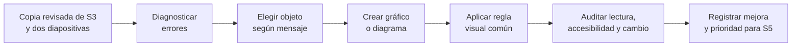

# Sesión 4 — Composición y objetos II

## 1. Ficha de sesión

- **Identificador:** UF0323-S04
- **Título:** Composición y objetos II
- **Bloque pedagógico:** B3, Composición y objetos
- **Contenido oficial:** 4. Trabajo con objetos
- **Duración:** 4 horas (240 minutos)
- **Herramienta principal:** Microsoft PowerPoint, con las funciones disponibles en el equipo.
- **Prerrequisitos:** copia local editable revisada en la sesión 3, estado inicial o registro local «antes», prioridad escrita de la sesión 3 y manejo básico de PowerPoint.
- **Trabajo:** individual, local y con datos ficticios o anonimizados. No se requiere cuenta, conexión ni transferencia de archivos.
- **Materiales:** equipo individual, PowerPoint, carpeta local, copia de la sesión 3, registro comparativo y esta guía.

### Distribución temporal exacta

| Tramo | Tiempo | Trabajo |
|---|---:|---|
| Revisión de errores | 30 min | Recuperar la copia de la sesión 3, conservar el «antes» y diagnosticar dos diapositivas (M1/E1). |
| Gráficos | 60 min | M2 y E2: crear, leer y revisar un gráfico con datos ficticios. |
| Diagramas | 50 min | M3 y E3: crear y leer un diagrama de proceso. |
| Pausa | 10 min | Descanso. |
| Consistencia visual | 50 min | M4/E4: aplicar una regla de composición y formato entre diapositivas. |
| Auditoría y mejora | 40 min | M5, E5, comparación antes/después y prioridad para la sesión 5. |
| **Total** | **240 min** | **30 + 60 + 50 + 10 + 50 + 40 = 240 min.** |

## 2. Objetivos observables

Al finalizar, el alumnado podrá:

- elegir entre texto, gráfico y diagrama según el mensaje y el destinatario;
- crear en PowerPoint un gráfico con título, categorías, valores, unidades y lectura;
- crear un diagrama con formas, conectores, etiquetas y orden comprensible;
- aplicar consistencia de tipografía, alineación, márgenes, rellenos, líneas,
  tamaño, proporción y contraste;
- auditar etiquetas, texto alternativo, orden de lectura y dependencia del color;
- conservar una copia local mejorada, un registro antes/después y una prioridad para la sesión 5.

## 3. Mapa visual y secuencia

**Lectura guiada:** se parte de dos diapositivas de la sesión 3, se localiza una
mejora verificable, se elige el objeto informativo pertinente, se formatea sin
decoración innecesaria y se comprueba la lectura por más de un canal.

### Alternativa textual accesible

1. Abrir la copia de la sesión 3 y localizar dos diapositivas comparables.
2. Registrar un problema de composición antes de editar.
3. Elegir texto, gráfico o diagrama según la pregunta del destinatario.
4. Crear o ajustar el objeto y aplicar una regla visual común.
5. Revisar etiquetas, contraste, texto alternativo, orden y teclado.
6. Registrar el cambio antes/después y la prioridad para la sesión 5.

### Si no tienes la copia editable de la sesión 3

Reconstruye dos diapositivas mínimas en una presentación nueva, sin crear ni
buscar recursos adicionales:

1. En la primera diapositiva escribe el título **Seguimiento de solicitudes** y
   el texto «Comparar el registro antiguo con el registro uniforme». Añade dos
   rectángulos etiquetados «Registro antiguo» y «Registro uniforme».
2. En la segunda escribe el título **Proceso de respuesta** y el texto «Orden de
   atención de una solicitud». Añade cuatro rectángulos con los pasos «Recibir
   solicitud», «Revisar datos», «Registrar seguimiento» y «Confirmar respuesta»;
   únelos con conectores.
3. Guarda esa presentación como copia local y anota que es el estado inicial
   reconstruido. Usa datos ficticios y continúa con el diagnóstico de M1.

## 4. Reto inicial

La copia de la sesión 3 contiene dos diapositivas que deben mejorar sin perder
el trabajo original. El reto consiste en comparar ambas versiones y hacer que la
información se entienda mejor mediante un **gráfico o diagrama pertinente**,
composición ordenada, legibilidad y contraste. El gráfico se usará para comparar
valores; el diagrama de proceso, para mostrar una secuencia. No se impone una solución
visual única: la elección debe justificarse por el mensaje.

Antes de editar, conserva una copia local del estado inicial o un registro local fechado.
Después registra, para cada cambio, «antes → operación → ahora →
efecto». El archivo no se entrega: permanece local para el trabajo posterior.

**Pregunta guía:** ¿qué objeto y qué regla de composición permiten que el
destinatario comprenda el mensaje de estas dos diapositivas con menos esfuerzo?

## 5. Conceptos explicados

### 5.1 Gráfico frente a diagrama

Un gráfico representa valores que se comparan o que cambian entre categorías.
Necesita categorías identificables, valores, unidades y una lectura que destaque
una diferencia o tendencia. Un diagrama representa relaciones: puede ordenar un
proceso, mostrar una jerarquía o conectar elementos relacionados. Sus formas,
conectores y etiquetas deben hacer visible esa relación.

La elección depende de la pregunta que debe responder el destinatario, no de qué
objeto resulta más llamativo. «¿Cuánto hay en cada categoría?» orienta hacia un
gráfico; «¿qué ocurre después?» orienta hacia un proceso; «¿cómo se relacionan?»
orienta hacia un diagrama. Si una frase breve comunica lo mismo, no se añade un
objeto innecesario.

### 5.2 Objeto informativo y objeto decorativo

Un objeto informativo aporta datos, estructura o significado: una columna del
gráfico, una forma etiquetada o un conector son parte de la explicación. Debe
tener un lugar, tamaño y formato que favorezcan su lectura. Un objeto decorativo
puede mejorar el ambiente visual, pero no debe competir con el mensaje ni ser la
única señal de una relación. Si se elimina un objeto decorativo, la información
debe seguir siendo comprensible.

### 5.3 Consistencia y formato

La consistencia significa repetir reglas funcionales, no hacer idénticas todas
las diapositivas. Elementos con la misma función suelen compartir tipografía,
tamaño, alineación y margen. La alineación fija ejes; los márgenes evitan que el
contenido quede pegado al borde; el espaciado y los rellenos separan grupos; las
líneas delimitan o conectan. Los estilos de texto, listas, etiquetas y párrafos
deben poder reconocerse sin depender de una preferencia subjetiva.

El contraste separa texto y objeto del fondo. El tamaño y la proporción afectan a
la legibilidad: se cambia una forma desde una esquina para no deformarla. El
relleno y la línea deben apoyar la jerarquía, no convertir el objeto en una
decoración. Sombras, 3D, WordArt, audio, vídeo y efectos quedan como ampliaciones
breves y no son necesarios para completar la sesión.

### 5.4 Etiquetas, texto alternativo y destinatario

Una etiqueta nombra la categoría, el paso o la relación que el lector necesita
entender. «Serie 1» o «imagen» no son etiquetas suficientes si no explican su
función. El texto alternativo describe el contenido relevante y su propósito:
para un gráfico, qué compara y cuál es su lectura principal; para un diagrama,
qué secuencia o relación representa. Un objeto puramente decorativo no debe
ocultar el contenido informativo.

La revisión siempre considera al destinatario: una persona que no conozca la
convención de colores debe poder seguir el mensaje mediante texto, formas,
etiquetas, conectores y orden. El Panel de selección y la navegación por teclado
permiten comprobar que el orden de los objetos no contradice el orden visual.

## 6. Demostraciones completas en PowerPoint

Los nombres de los menús pueden variar según la versión; se utiliza la función
equivalente. Todas las demostraciones son locales y usan datos ficticios.

### M1. Diagnosticar y priorizar mejoras (orientación: 15 min)

- **Finalidad:** encontrar un problema observable en dos diapositivas y decidir qué corregir primero.
- **Prerrequisitos:** copia de S3, estado inicial y vistas Normal y Clasificador.
- **Pasos:**
  1. Abrir las dos diapositivas y localizar títulos u objetos con la misma función.
  2. Comparar tipografía, tamaño, alineación, márgenes, espaciado, rellenos, líneas y etiquetas.
  3. Anotar «problema → operación → efecto esperado» y elegir la prioridad que más afecta a la lectura.
  4. Conservar el estado inicial y aplicar solo esa mejora.
- **Resultado visible:** prioridad razonada y una diferencia de composición comprobable.
- **Error frecuente:** cambiar colores por gusto antes de identificar el problema o editar el original.
- **Comprobación:** explicar qué objeto se modificó, qué operación se hizo y qué puede observar el destinatario después.

**Ejercicio intercalado:** realizar **E1. Diagnóstico y prioridad** antes de continuar con el gráfico.

### M2. Crear y leer un gráfico con datos ficticios (orientación: 30 min)

- **Finalidad:** convertir una tabla pequeña en una comparación interpretable.
- **Prerrequisitos:** una diapositiva cuya pregunta requiera comparar valores.
- **Pasos:**
  1. Insertar un gráfico de columnas agrupadas.
  2. Sustituir los datos por: Semana 1 (12, 15), Semana 2 (14, 18), Semana 3 (13, 21), Semana 4 (15, 24), con series «Registro antiguo» y «Registro uniforme».
  3. Añadir el título «Solicitudes resueltas por semana», categorías y la unidad «número de solicitudes».
  4. Escribir una lectura: el registro uniforme supera al antiguo en las cuatro semanas y la diferencia crece.
- **Resultado visible:** gráfico titulado, etiquetado e integrado con una lectura textual.
- **Error frecuente:** dejar «Serie 1», omitir unidades o inventar una causa.
- **Comprobación:** responder qué se compara, en qué unidad y qué diferencia hay en la semana 4.

**Ejercicio intercalado:** realizar **E2. Gráfico con datos ficticios** y conservar la lectura en el registro local.

### M3. Crear y leer un diagrama de proceso (orientación: 25 min)

- **Finalidad:** representar una secuencia mediante formas y conectores.
- **Prerrequisitos:** mensaje definido y manejo básico de rectángulos, conectores y flechas.
- **Pasos:**
  1. Escribir los pasos ficticios: «Recibir solicitud → Revisar datos → Registrar seguimiento → Confirmar respuesta».
  2. Crear cuatro formas, alinearlas de izquierda a derecha y numerarlas.
  3. Unirlas con conectores anclados y añadir etiquetas comprensibles.
  4. Revisar que el recorrido se entiende sin usar el color como única señal.
- **Resultado visible:** diagrama con cuatro pasos, conectores unidos y orden de lectura explícito.
- **Error frecuente:** usar líneas sueltas, cruzar conectores o confiar solo en dos colores.
- **Comprobación:** mover una forma y verificar que el conector sigue unido; leer la secuencia con una lista textual.

**Ejercicio intercalado:** realizar **E3. Diagrama de proceso** antes de la pausa.

### M4. Aplicar consistencia y formato (orientación: 25 min)

- **Finalidad:** aplicar una regla común de formato a objetos equivalentes en dos diapositivas.
- **Prerrequisitos:** gráfico o diagrama terminado y prioridad de M1.
- **Pasos:**
  1. Escribir una regla limitada, por ejemplo: títulos con el mismo tamaño y margen, o etiquetas con el mismo relleno y línea.
  2. Seleccionar por función y ajustar tipografía, alineación, márgenes, relleno, línea, tamaño, proporción y contraste.
  3. Revisar la diapositiva en Clasificador y retirar formato que distraiga.
  4. Comparar antes y después sin convertir la regla en un estilo global.
- **Resultado visible:** objetos equivalentes reconocibles y legibles en ambas diapositivas.
- **Error frecuente:** incluir objetos con funciones distintas o deformar una forma.
- **Comprobación:** alejar el zoom y explicar qué regla se repite y cómo ayuda a leer.

**Ejercicio intercalado:** realizar **E4. Consistencia entre diapositivas** durante el tramo de consistencia visual.

### M5. Auditar accesibilidad y comparar antes/después (orientación: 20 min)

- **Finalidad:** comprobar la mejora por texto, vista, teclado y Panel de selección.
- **Prerrequisitos:** copia actual, estado inicial y gráfico o diagrama seleccionable.
- **Pasos:**
  1. Leer sin interpretar el color: localizar títulos, etiquetas, unidades y conectores.
   2. Revisar contraste, tamaño, orden visual y nombres/orden del Panel de selección. Confirmar que el texto no queda cortado, que las etiquetas son legibles en vista Normal y que el mensaje sigue siendo comprensible sin depender del color.
  3. Navegar por teclado y añadir texto alternativo que describa contenido, relación y mensaje.
  4. Registrar dos cambios como «antes → operación → ahora → efecto» y una prioridad para S5.
- **Resultado visible:** auditoría local, texto alternativo o descripción equivalente y comparación verificable.
- **Error frecuente:** escribir solo «gráfico de colores» o marcar accesibilidad sin probar el orden.
- **Comprobación:** describir el objeto sin depender del color y señalar en pantalla la evidencia de cada afirmación.

**Ejercicio intercalado:** realizar **E5. Auditoría y antes/después** en el tramo de auditoría y mejora.

## 7. Ejercicios individuales intercalados

Todos los ejercicios se realizan individualmente en PowerPoint, sin entrega
formal. El resultado queda en la copia local o en el registro local; la revisión es
autónoma y puede consistir en mostrar la pantalla en el momento indicado.

**Clasificación visible:** E1 y E4 son **casos abiertos breves**; E2 y E3 son
**prácticas guiadas**; E5 es una **práctica guiada de auditoría**. Al no ser
ejercicios autocorregibles, los casos abiertos y las prácticas guiadas no usan
`question` ni `success`.

### E1. Diagnóstico y prioridad (orientación: 15 min)

- **Finalidad:** reconocer una inconsistencia antes de editar.
- **Herramienta:** PowerPoint; copia de S3, registro «antes» y dos diapositivas.
- **Contexto:** compara elementos equivalentes de una presentación profesional con datos ficticios.
- **Instrucciones:** registra un problema de tipografía, alineación, margen, espaciado, formato o etiqueta; elige una prioridad y una regla.
- **Pasos:** observar en Normal; contrastar en Clasificador; escribir «problema → operación → efecto»; aplicar una sola mejora.
- **Resultado esperado:** cambio visible y prioridad razonada.
- **Comprobaciones:** el problema inicial puede señalarse y la mejora puede observarse sin borrar el «antes».
- **Criterios de éxito:** función equivalente, regla concreta y evidencia visible: el texto no queda cortado y la mejora se aprecia en vista Normal; no se impone una solución estética única.
- **Ayuda/errores:** comparar primero ejes y márgenes; evitar «más bonito» y cambiar todo a la vez.
- **Revisión:** autónoma al terminar; se explica la decisión si se solicita.
- **Accesibilidad:** describir el problema con texto y comprobar con zoom, teclado o Panel de selección.

### E2. Gráfico con datos ficticios (orientación: 30 min)

- **Finalidad:** crear y explicar una comparación de valores.
- **Herramienta:** PowerPoint, gráfico de columnas y la tabla de M2.
- **Contexto:** el destinatario necesita comparar solicitudes resueltas por semana.
- **Instrucciones:** inserta el gráfico, conserva exactamente los datos, incluye título, categorías, valores, unidad y lectura textual.
- **Pasos:** definir la pregunta; introducir datos; revisar leyenda y etiquetas; añadir texto alternativo y lectura.
- **Resultado esperado:** gráfico integrado que responde la pregunta sin afirmar causas no demostradas.
- **Comprobaciones:** comprobar los valores de las cuatro semanas y responder qué ocurre en la semana 4.
- **Criterios de éxito:** datos exactos, series descriptivas, unidad visible y lectura fiel. Los valores del gráfico conservan los de la tabla, el texto no queda cortado, las etiquetas son legibles en vista Normal y el mensaje se entiende sin depender del color; admite distintas composiciones justificadas.
- **Ayuda/errores:** comparar tabla y gráfico; corregir «Serie 1», unidades omitidas o categorías mezcladas.
- **Revisión:** autónoma en PowerPoint al finalizar.
- **Accesibilidad:** texto de lectura además del color, contraste, tamaño, texto alternativo y orden comprobado con teclado o Panel.

### E3. Diagrama de proceso (orientación: 25 min)

- **Finalidad:** hacer visible una secuencia mediante objetos relacionados.
- **Herramienta:** PowerPoint; formas, conectores y etiquetas.
- **Contexto:** representa el proceso ficticio de M3, sin datos personales reales.
- **Instrucciones:** crea cuatro pasos, conéctalos, numéralos y añade una descripción del propósito del proceso.
- **Pasos:** escribir pasos; insertar y alinear formas; anclar conectores; revisar contraste y orden.
- **Resultado esperado:** diagrama de proceso legible, con orden explícito y alternativa textual equivalente.
- **Comprobaciones:** mover una forma y comprobar que el conector sigue unido; verificar que las etiquetas son legibles en vista Normal y leer el recorrido sin color.
- **Criterios de éxito:** cuatro pasos distinguibles, conectores unidos al mover las formas, etiquetas descriptivas, texto no cortado, orden y contraste; no se impone una distribución visual única.
- **Ayuda/errores:** numerar si el recorrido confunde; evitar líneas no ancladas y conectores cruzados.
- **Revisión:** autónoma al terminar, con comentario opcional sobre la decisión.
- **Accesibilidad:** numeración, etiquetas, texto alternativo y navegación por teclado o Panel.

### E4. Consistencia entre diapositivas (orientación: 25 min)

- **Finalidad:** transferir una regla de formato a objetos equivalentes.
- **Herramienta:** PowerPoint; gráfico o diagrama de E2/E3 y dos diapositivas de la copia.
- **Contexto:** la presentación debe conservar una regla funcional sin hacerse uniforme por obligación.
- **Instrucciones:** define una regla para tipografía, alineación, márgenes, relleno, línea, tamaño, proporción o contraste y aplícala donde corresponda.
- **Pasos:** anotar regla y objetos; ajustar formato; comparar en Clasificador; escribir «antes → operación → ahora → efecto».
- **Resultado esperado:** consistencia observable y justificación local.
- **Comprobaciones:** reconocer funciones equivalentes a distancia y leer las etiquetas.
- **Criterios de éxito:** regla limitada, aplicación coherente, proporción y contraste adecuados; el texto no queda cortado, las etiquetas son legibles en vista Normal y la justificación se basa en la lectura, no solo en el color.
- **Ayuda/errores:** empezar por un atributo; no cambiar estilos globales ni agrupar funciones distintas.
- **Revisión:** autónoma en PowerPoint; no hay solución visual única.
- **Accesibilidad:** la regla no depende solo del color o del tamaño; se mantienen etiquetas y contraste.

### E5. Auditoría y antes/después (orientación: 20 min)

- **Finalidad:** justificar la mejora y dejar continuidad para la sesión 5.
- **Herramienta:** PowerPoint; copia actual, estado inicial, Panel de selección y ficha de comprobación.
- **Contexto:** se auditan las dos diapositivas mejoradas, no una entrega final.
- **Instrucciones:** registra al menos dos cambios con la secuencia «antes → operación → ahora → efecto» y una limitación pendiente.
- **Pasos:** leer sin depender del color; revisar etiquetas y texto alternativo; navegar con teclado y Panel; escribir prioridad para S5.
- **Resultado esperado:** auditoría local, comparación razonada y prioridad accionable.
- **Comprobaciones:** cada afirmación apunta a una señal en pantalla, Panel, teclado o descripción textual.
- **Criterios de éxito:** dos cambios con efecto, contraste, orden, etiquetas, texto alternativo y prioridad concreta. Se comprueba texto no cortado, etiquetas legibles en vista Normal, mensaje comprensible sin color, conectores unidos al mover formas y valores del gráfico conservados; se marca como pendiente lo que no pueda demostrarse.
- **Ayuda/errores:** preguntar «¿qué se leía antes?, ¿qué hice?, ¿qué se localiza ahora?»; no comparar solo colores.
- **Revisión:** autónoma al terminar, con contraste individual opcional.
- **Accesibilidad:** se admite registro escrito o verbal transcrito, zoom, teclado y tiempo suficiente.

## 8. Producto y autoestudio

Queda una **copia local editable mejorada** de las dos diapositivas, con una
mejora de consistencia, un gráfico o diagrama pertinente, formato esencial,
etiquetas legibles, auditoría de accesibilidad y registro antes/después. El
registro incluye una prioridad para la sesión 5. No se entrega ni se envía; el
trabajo continúa localmente.

Para autoestudio, repetir el ciclo sobre otra diapositiva: diagnosticar, elegir
objeto, crear o ajustar, aplicar una regla y auditar. Organigramas específicos,
WordArt, audio, vídeo, sombras, 3D y efectos son ampliaciones no obligatorias.

## 9. Trazabilidad curricular

La tabla limita la afirmación a las filas realmente trabajadas en esta sesión.
La numeración de criterios es la operativa de 2011.

| Referencia verificada | Evidencia de esta sesión |
|---|---|
| **B3 · contenido oficial 4: Trabajo con objetos** | E2: **4.29–4.30** (gráficos y creación de gráficos); E3: **4.31** (diagramas); E1/E4: **4.35–4.37** (formato de objetos, rellenos y líneas). **Cobertura parcial: integración de gráficos, diagramas y formato de objetos**; no se atribuyen 4.10–4.15, 4.20–4.24 ni 4.26. |
| **CE1.4** | **Cobertura parcial: documentación de actividades y resultados de una mejora local de presentación**. No se demuestran identificación de elementos, interpretación de requisitos ni decisión de instalación. |
| **CE2.3** | **Cobertura parcial: comprobación y corrección de defectos de composición y lectura**. No se cubren el ensayo temporalizado, la preparación para proyección ni el guardado y la protección de la presentación. |

**Referencia verificable:** `../../planificacion/matriz-trazabilidad-curricular.md`,
§3.2 (C1, C2 y CE), §6 (contenido 4, filas 4.29–4.31 y 4.35–4.37) y §7
(cobertura de capacidades). La matriz identifica el bloque de UF0323 en el RD
645/2011, pp. 246–249. No se afirma la cobertura del resto de B3 ni de
contenidos reservados a sesiones posteriores.

## 10. Síntesis y continuidad

La composición mejora cuando la elección del objeto responde al mensaje, las
reglas visuales se aplican por función y la accesibilidad se comprueba con texto,
orden, contraste y teclado. El gráfico sirve para comparar datos; el diagrama,
para mostrar relaciones o procesos; ambos necesitan etiquetas y una lectura.

La transición queda así:

| Momento | Estado de trabajo |
|---|---|
| **Sesión 3 → 4** | Copia editable, estado inicial o registro «antes» y prioridad de composición. |
| **Sesión 4** | Dos diapositivas mejoradas con gráfico o diagrama, consistencia, formato y auditoría. |
| **Sesión 4 → 5** | Copia local, registro antes/después y prioridad para documentación y coherencia final. |

La sesión 5 retomará esa prioridad para documentación, estilos globales,
plantillas, fondos o patrones, notas del orador y preparación de la exposición.
No se adelantan esas decisiones en esta sesión.
