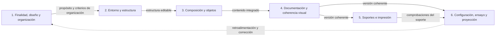

# Arquitectura pedagógica de UF0323

## Propósito y límites

Este documento propone una arquitectura pedagógica para **UF0323,
Aplicaciones informáticas para presentaciones: gráficas de información**. La
arquitectura reorganiza los ocho bloques de contenidos oficiales en seis
bloques pedagógicos relacionados, sin alterar su alcance ni su orden de
referencia normativa.

La propuesta es una decisión pedagógica de secuenciación conceptual. No
distribuye las 30 horas, no diseña sesiones, actividades ni evaluación, y no
define metodología, instrumentos, rúbricas, materiales o documentos DOCX. La
duración de 30 horas es un dato normativo, no una distribución dentro de esta
arquitectura.

## Marco normativo y decisiones separadas

### Requisitos normativos

La extracción curricular identifica UF0323 como unidad formativa de 30 horas,
correspondiente a RP5 y RP7 en lo referente a presentaciones. El currículo
establece dos capacidades:

- **C1:** establecer el diseño de las presentaciones teniendo en cuenta las
  características de la empresa y su organización.
- **C2:** utilizar las funciones de las aplicaciones de presentaciones gráficas
  presentando documentación e información en diferentes soportes e integrando
  objetos de distinta naturaleza.

El currículo de 2011 recoge los ocho bloques numerados y sus contenidos. La
superación de **UF0319** es condición normativa previa para acceder a UF0323;
UF0320, UF0321, UF0322 y UF0323 pueden programarse de manera independiente una
vez superada UF0319. Esta condición de acceso entre unidades no prescribe el
orden interno de los seis bloques de este documento.

La normativa también conserva una duración máxima de 30 horas susceptibles de
formación a distancia para UF0323. No se convierte aquí ese dato en una
planificación temporal.

### Decisiones pedagógicas

La propuesta parte de una lógica de producto: primero se define la finalidad y
la organización de una presentación; después se construye su estructura y sus
objetos; a continuación se documenta y se unifica visualmente; finalmente se
prepara para un soporte y se comprueba en el contexto de exposición. Esta
secuencia reduce saltos entre decisiones de contenido, edición, salida y
proyección.

Los bloques oficiales se agrupan cuando comparten una decisión didáctica, pero
se mantienen visibles como unidades de trazabilidad. Agrupar no significa
suprimir contenidos: cada bloque oficial sigue teniendo una ubicación explícita
en la matriz de este documento.

## Punto de partida y dependencias

### UF0319 → UF0323: dependencia normativa

La flecha siguiente expresa la condición normativa de acceso:

```text
UF0319 superada ───────────────► acceso a UF0323
```

No expresa que el alumnado deba haber superado UF0320, UF0321 o UF0322, ni
determina una secuencia didáctica dentro de UF0323.

### Dependencias didácticas internas

Dentro de UF0323 sí se propone una progresión conceptual. El bloque siguiente
depende de decisiones y nociones construidas en los anteriores, aunque puede
revisitar sus resultados cuando sea necesario:



El diagrama representa dependencias de aprendizaje, no una secuencia de
sesiones. El retorno final indica que las comprobaciones pueden revelar la
necesidad de revisar una decisión inicial de diseño, organización o formato.

## Seis bloques pedagógicos

### 1. Finalidad, diseño y organización

**Bloque oficial cubierto:** 1, «Diseño, organización y archivo de las
presentaciones».

Este bloque establece para qué se presenta la información y qué relación existe
entre la presentación, la imagen corporativa y la organización. Integra claridad,
persuasión, respeto de normas de estilo, evaluación de resultados,
organización, archivo, confidencialidad y entrega.

Su función de inicio es convertir una petición de comunicación en una intención
de presentación reconocible: destinatario, información que debe comprenderse,
imagen que debe transmitirse y condiciones de archivo y entrega. Las decisiones
de diseño no se tratan como decoración, sino como parte de la calidad,
seguridad, integridad y confidencialidad del documento.

**Dependencia de entrada:** conocimientos de acceso y manejo básico de
archivos, entendidos como referencia técnica no legal. **Dependencia de salida:**
proporciona el propósito y los criterios que orientan la estructura, la
composición y la selección posterior de soportes.

### 2. Entorno y estructura

**Bloques oficiales cubiertos:** 2, «Introducción y conceptos generales», y 3,
«Acciones con diapositivas».

El segundo bloque pedagógico reúne el reconocimiento del entorno de la
aplicación con las operaciones que dan forma al conjunto de diapositivas.
Incluye ejecución y salida de la aplicación, creación, grabación, cierre y
apertura, estructura de pantalla, vistas —normal, clasificador y esquema—,
además de insertar, eliminar, duplicar y ordenar diapositivas.

La agrupación se justifica porque el alumnado necesita comprender dónde se
organiza una presentación y cómo se modifica su secuencia antes de trabajar
con los objetos que contiene. Las vistas aportan distintos modelos de la misma
estructura: edición, orden global y esquema de información.

**Dependencia de entrada:** finalidad, criterios de organización y archivo del
bloque 1. **Dependencia de salida:** deja una estructura de diapositivas sobre
la que se pueden insertar y disponer objetos sin confundir la arquitectura del
conjunto con el contenido de cada diapositiva.

### 3. Composición y objetos

**Bloque oficial cubierto:** 4, «Trabajo con objetos».

Este bloque desarrolla la composición de la información dentro de la
diapositiva. Comprende selección, desplazamiento, eliminación, tamaño,
duplicación, reubicación, alineación y distribución; trabajo con textos,
formato de párrafos, listas y estilos; tablas; dibujos y formas; imágenes;
gráficos; diagramas; texto artístico; sonidos y películas; y el formato de
objetos mediante rellenos, líneas y efectos.

La progresión interna va de la manipulación común de objetos a su integración
como información. Texto, tabla, imagen, gráfico, diagrama y medios no se
consideran equivalentes por apariencia: se seleccionan y disponen según lo que
deben comunicar. La alineación, distribución y formato hacen visible la
relación entre los elementos y preparan la coherencia del bloque siguiente.

**Dependencia de entrada:** estructura de diapositivas y criterios de claridad
del bloque 2, junto con el propósito del bloque 1. **Dependencia de salida:**
produce una composición integrada que puede documentarse, estilizarse y
prepararse para distintos soportes.

### 4. Documentación y coherencia visual

**Bloques oficiales cubiertos:** 5, «Documentación de la presentación», y 6,
«Diseños o Estilos de Presentación».

Este bloque une dos dimensiones de una presentación terminada. La primera hace
explícita la información de apoyo mediante comentarios y notas del orador. La
segunda establece una apariencia consistente mediante plantillas de estilos,
combinación de colores, fondos y patrones.

La unión es pedagógicamente útil porque documentar no es solo añadir texto
auxiliar y aplicar un estilo no es solo cambiar colores. Ambas operaciones
contribuyen a que la presentación sea comprensible, reutilizable y coherente
con la organización: las notas apoyan la comunicación oral y los estilos
mantienen una regla visual común entre diapositivas.

**Dependencia de entrada:** objetos y relaciones compositivas del bloque 3.
**Dependencia de salida:** deja una versión documentada y visualmente coherente
que puede adaptarse a papel, pantalla, red o proyección.

### 5. Soportes e impresión

**Bloque oficial cubierto:** 7, «Impresión de diapositivas en diferentes
soportes».

Este bloque aborda la salida física y las decisiones de configuración asociadas:
configuración de página, encabezados, pies, numeración, formatos de impresión y
opciones de impresión. Su objeto no es añadir una salida al final de forma
automática, sino relacionar el formato de la información con el soporte en el
que será utilizada.

La presentación conserva su finalidad, pero el soporte puede exigir una
comprobación distinta de legibilidad, orden, información auxiliar y cantidad de
elementos visibles. Por eso este bloque depende de una versión ya organizada,
compuesta y estilizada, y alimenta las comprobaciones finales.

**Dependencia de entrada:** documentación y coherencia visual del bloque 4.
**Dependencia de salida:** proporciona una salida configurada y criterios de
comprobación que deben considerarse junto con la infraestructura de exposición.

### 6. Configuración, ensayo y proyección

**Bloque oficial cubierto:** 8, «Presentación de diapositivas teniendo en cuenta
el lugar e infraestructura».

Este bloque integra animación de elementos, transición de diapositivas,
intervalos, configuración de la presentación, presentación con orador,
presentación en exposición, presentaciones personalizadas, conexión y
configuración del proyector, ensayo y proyección.

Constituye el cierre porque pone a prueba la relación entre contenido,
secuencia, tiempo, modo de presentación, lugar e infraestructura. El ensayo no
es una acción aislada: permite detectar defectos, corregirlos y proponer
mejoras antes de poner la presentación a disposición de sus destinatarios.

**Dependencia de entrada:** composición, documentación, estilo y soporte de los
bloques 3, 4 y 5. **Resultado de la progresión:** una presentación configurada
para su contexto de uso y sometida a comprobaciones de calidad, sin convertir
este documento en un diseño de evaluación.

## Matriz de trazabilidad

La matriz usa como numeración operativa la de 2011: en 2011, los criterios de C2
son CE2.1, CE2.2 y CE2.3. En 2009, el texto transcrito vuelve a numerar dos
criterios de C2 como CE1.3 y CE1.4. Se conserva la correspondencia histórica
**CE2.2 (2011) ↔ CE1.3 (2009)** y **CE2.3 (2011) ↔ CE1.4 (2009)**, sin corregir
ni ocultar la redacción de la disposición de 2009.

| Bloque oficial | Contenido oficial resumido | Bloque pedagógico | Criterios relacionados | Justificación de cobertura |
|---|---|---|---|---|
| 1. Diseño, organización y archivo | Imagen corporativa; diseño claro y persuasivo; evaluación; archivo, confidencialidad y entrega. | 1. Finalidad, diseño y organización | C1; CE1.1, CE1.2, CE1.3 y CE1.4 | Define propósito, calidad, organización, archivo y condiciones de entrega. |
| 2. Introducción y conceptos generales | Ejecución, salida, creación, grabación, apertura, cierre, pantalla y vistas. | 2. Entorno y estructura | C2; CE2.1 | Sitúa las prestaciones, procedimientos y asistentes en el entorno de trabajo. |
| 3. Acciones con diapositivas | Inserción, eliminación, duplicación y ordenación. | 2. Entorno y estructura | C2; CE2.1, CE2.2 y CE2.3 | Construye y mantiene la secuencia que organiza la presentación. |
| 4. Trabajo con objetos | Textos, tablas, dibujos, imágenes, gráficos, diagramas, medios y formato. | 3. Composición y objetos | C2; CE2.2 y CE2.3 | Integra objetos de distinta naturaleza y permite aplicar formato, animación o temporalización cuando corresponda. |
| 5. Documentación de la presentación | Comentarios y notas del orador. | 4. Documentación y coherencia visual | C1; CE1.1 y CE1.3. C2; CE2.2 y CE2.3 | Hace explícito el apoyo a la comunicación y a la revisión de la presentación. |
| 6. Diseños o Estilos de Presentación | Plantillas, colores, fondos y patrones. | 4. Documentación y coherencia visual | C1; CE1.1 y CE1.4. C2; CE2.2 | Relaciona imagen corporativa, claridad y formato final. |
| 7. Impresión de diapositivas en diferentes soportes | Página, encabezados, pies, numeración, formatos y opciones de impresión. | 5. Soportes e impresión | C1; CE1.3 y CE1.4. C2; CE2.2 y CE2.3 | Selecciona y configura una salida adecuada al soporte y permite comprobar resultados. |
| 8. Presentación según lugar e infraestructura | Animación, transición, intervalos, modos de presentación, proyector, ensayo y proyección. | 6. Configuración, ensayo y proyección | C1; CE1.3 y CE1.4. C2; CE2.2 y CE2.3 | Integra configuración, soporte, infraestructura, ensayo, corrección y protección de la versión final. |

### Cobertura de capacidades y criterios

- **C1 / CE1.1:** queda principalmente cubierto por los bloques pedagógicos 1 y
  4, al relacionar imagen corporativa, claridad, persuasión y coherencia visual.
- **C1 / CE1.2:** queda principalmente cubierto por el bloque 1, con la
  organización, archivo, seguridad, integridad y confidencialidad.
- **C1 / CE1.3:** recorre los bloques 1, 4, 5 y 6, porque la comprobación de
  resultados, la corrección y la entrega afectan a la presentación completa.
- **C1 / CE1.4:** recorre los seis bloques, desde la elección del formato y
  medio hasta la comprobación, movimiento, copia o eliminación conforme a las
  normas aplicables.
- **C2 / CE2.1 (2011):** se sitúa de forma directa en los bloques 2 y 3, que
  introducen prestaciones, procedimientos, asistentes, entorno, vistas y
  acciones con diapositivas.
- **C2 / CE2.2 (2011):** se desarrolla transversalmente en los bloques 3, 4, 5
  y 6 mediante formatos, soportes, integración de objetos, animaciones, audio,
  vídeo y consulta de ayuda cuando sea necesario.
- **C2 / CE2.3 (2011):** se concentra en los bloques 4, 5 y 6: insertar
  información, animar, temporalizar, ensayar, corregir, guardar en formatos
  adecuados y proteger frente a modificaciones no deseadas.

## Discrepancias documentales que permanecen abiertas

### Numeración de criterios 2009/2011

El RD 1210/2009 conserva, dentro de C2, dos criterios numerados como CE1.3 y
CE1.4. El RD 645/2011 presenta esos criterios como CE2.2 y CE2.3 y mantiene
CE2.1 para la identificación de prestaciones, procedimientos y asistentes. Esta
arquitectura utiliza la numeración de 2011 para describir la cobertura de C2,
pero conserva expresamente la correspondencia documental con 2009:

| Función curricular | RD 1210/2009 | RD 645/2011 |
|---|---|---|
| Identificar prestaciones, procedimientos y asistentes | CE2.1 | CE2.1 |
| Elaborar en distintos soportes e integrar objetos | CE1.3 | CE2.2 |
| Insertar, animar, temporalizar, ensayar, corregir, guardar y proteger | CE1.4 | CE2.3 |

La tabla es una correspondencia de lectura, no una corrección de la disposición
de 2009. Las referencias normativas operativas son el bloque de 2009 de la
extracción curricular (líneas 52–85) y el bloque de 2011 (líneas 242–273).

### MF0233_2 / UF0323

La fuente normativa consultada relaciona UF0323 con **MF0233_2, Ofimática**, y
la extracción curricular adopta esa referencia. El inventario de documentos
registra, sin resolverla, una discrepancia administrativa: los DOCX consignan
**UF0323, Instalación y configuración de aplicaciones informáticas**.

Esta arquitectura mantiene abierta la discrepancia. No usa los DOCX para
alterar C1, C2, criterios, contenidos o duración, y no decide qué referencia
administrativa debe prevalecer. La cuestión requiere confirmación por la
autoridad documental competente antes de trasladar esta arquitectura a esos
documentos.

## Referencias y trazabilidad de fuentes

Las referencias se limitan a los archivos incluidos en el alcance aprobado:

- Extracción curricular: `planificacion/extraccion-curriculo-oficial.md`,
  especialmente líneas 52–216, 242–381 y 397–435.
- Real Decreto 1210/2009: `normativa/BOE-A-2009-15054.txt`, artículo 4
  (líneas 50–59) y bloque curricular de UF0323 transcrito en la extracción.
- Real Decreto 645/2011: `normativa/BOE-A-2011-9930.txt`, artículo 4
  (líneas 58–66) y disposición final segunda (líneas 108–113), además del
  bloque curricular de UF0323 transcrito en la extracción.
- Prerrequisitos y dependencias de acceso:
  `planificacion/prerrequisitos-y-conocimientos-previos.md`.
- Inventario de la discrepancia administrativa:
  `planificacion/inventario-fuentes-y-documentos.md`.

Las páginas de los bloques curriculares fueron verificadas directamente en los
PDF: RD 1210/2009, pp. 128–132; RD 645/2011, pp. 246–249.

## Exclusiones de esta arquitectura

La síntesis común de esta arquitectura se encuentra en [estructura
definitiva](estructura-definitiva.md).

Este documento no distribuye horas, no diseña sesiones ni actividades, no
define evaluación detallada, instrumentos o rúbricas, y no prescribe materiales,
metodología o DOCX. Su función se limita a justificar la organización
conceptual, sus dependencias y su trazabilidad normativa.
